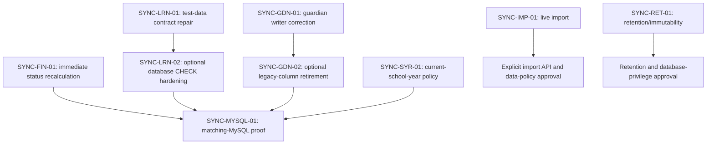

# Backend synchronization implementation plan

## Purpose and evidence boundary

This is an approval queue, not implementation authorization. It re-checks the current `feature/backend-foundation` checkout at `124a78637e36ee91fd0b3a126813b5a394305ab6`, including the uncommitted fee-synchronization work recorded in the repository ledger. It does not query, migrate, seed, recreate, or otherwise contact a development, shared, or production database.

The authority order is the current task, approved core requirements, and later accepted decisions. In particular, the current task confirms the twelve-digit LRN contract; the November 5 fee-assignment decision supersedes the older new-accounts-only fee wording for additions; the November 5 clearance-retirement decision supersedes older active-clearance requirements; and the November 7 import decision explicitly excludes a backend implementation.

## Confirmed mismatches and non-mismatches

| ID | Classification | Confirmed evidence | Consequence |
|---|---|---|---|
| SYNC-GDN-01 | Remediated implementation defect; accepted | `guardians.relationship` remains `NOT NULL`. `StudentController` now writes the validated relationship to that legacy column only for a newly created guardian, writes the link-specific pivot value, and encloses the student/guardian/link/audit sequence in a transaction. | Isolated SQLite tests prove valid persistence, audit-failure rollback, and that a link update does not overwrite the retained guardian-wide value. No migration or API contract change occurred. |
| SYNC-FIN-01 | Remediated implementation defect; accepted | `ApplyFeeItemToBillingAccountsAction` now invokes `RecalculateBillingStatusAction` after it creates the same-day installment and increments integer-centavo amounts, within the controller's existing transaction. | Isolated SQLite tests prove a formerly paid account and its new same-day installment are immediately `due_soon`. No migration, historical amount rewrite, or API contract change occurred. |
| SYNC-LRN-01 | Remediated test-data and coverage gap; accepted | Runtime schema, request validation, API serialization, search, billing/payment/report outputs, and live adapter already use `lrn`; no backend `student_no`/`studentNo` reference remains. The nine directly affected suites now use fictional twelve-digit LRNs, and request-boundary coverage rejects invalid formats while accepting leading zeroes. | Production endpoint contract remains unchanged. Isolated SQLite evidence covers synthetic fixture normalization and request validation; no installed records, migration, or API rename occurred. |
| SYNC-DOC-01 | Remediated documentation conflict; accepted | The owner approved reconciliation of active canonical student-identifier terminology. `Project-Specification.md` and its source-derived `Scope-and-Access-Control.md` view now use LRN/`lrn` consistently, while dated decision records retain their historical wording. | Documentation-only; no schema conversion, installed-record mutation, route, or API change occurred. |
| SYNC-GDN-02 | Approved target difference / data-quality follow-up | Pivot relationship was added and deterministically backfilled from the legacy guardian field. The legacy column remains required and several non-HTTP writers still create pivot links without the pivot attribute. | A later additive legacy-retirement workstream is possible, but must preserve legacy values and cannot invent guardian ownership or primary-contact rules. |
| SYNC-SYR-01 | Unresolved policy | `school_years.is_current` is indexed, not unique. Dashboard fails closed for zero/multiple rows; billing and statement paths select arbitrary current rows or sum all matching rows. | Do not write a uniqueness migration or management API until transition ownership and exact behavior are approved. |
| SYNC-IMP-01 | Approved future target difference | `import_batches` is generic storage only. No import route/controller/request/parser exists; the approved import decision is MockDB-only and explicitly says not to change backend files. | No backend import work is independently authorized. |
| SYNC-RET-01 | Unresolved policy plus environment gate | Application routes retain financial history, but no database append-only control exists; retention/purge and database privilege policy are unresolved. | No retention or immutability migration may be designed as if a policy exists. |

Historical clearance/exam-permit tables are not a mismatch: they are retained historical-only by explicit decision and have no active API route. Integer-centavo storage, payment/receipt uniqueness, restrictive financial foreign keys, the LRN unique key, and the fee account-item snapshot shape are implemented. Target-MySQL lock/constraint evidence remains unverified rather than failed.

## Dependency map

`SYNC-GDN-01`, `SYNC-FIN-01`, `SYNC-LRN-01`, and `SYNC-DOC-01` are accepted. The owner accepted the completed `SYNC-MYSQL-01` environment preflight at Friday, November 13, 2026 — 23:49:04 +08:00; target-MySQL validation itself remains environment-blocked because the repository/workstation preflight found no target version/collation matrix or owner-identified disposable database. Its fail-closed procedure is `Target-MySQL-Validation-Runbook.md`. The owner approved `SYNC-GDN-02` first at Saturday, November 14, 2026 — 00:04:22 +08:00, but it remains data- and environment-blocked until a read-only installed-data preflight is reviewed and matching-MySQL proof is possible. The owner approved `SYNC-LRN-02` at Saturday, November 14, 2026 — 00:07:34 +08:00, but it remains data- and environment-blocked until an aggregate invalid-format preflight is empty and exact target-engine CHECK behavior is proven. `SYNC-SYR-01`, `SYNC-IMP-01`, and `SYNC-RET-01` are blocked by named policy decisions.

## Implementation matrix

| Workstream | Priority | Current implementation and target | Exact affected files | Proposed change and data safety | API compatibility / validation | Approval dependency and completion criteria |
|---|---|---|---|---|---|---|
| **SYNC-GDN-01 — valid guardian payload persistence** | P0, implemented; accepted | The request accepts paired guardian fields. Student create/update now writes the required legacy relationship only for a newly created guardian, writes the link-specific pivot value, and records the audit event in one transaction. | `backend/app/Http/Controllers/Api/StudentController.php`; `backend/tests/Feature/StudentAccessTest.php`; `EducatraK-Knowledge-Base/02-Architecture/Backend-API-Contract.md`. | No migration or data rewrite. Existing guardian-wide values are preserved on later link changes; existing first-associated-guardian selection, shared-contact behavior, primary rule, and prior links are unchanged. | Request/response names and shapes remain unchanged: `guardian_name`, `guardian_relationship`, `guardian_email`, `guardian_mobile`; output remains `guardians[].relationship`. Focused coverage proves valid persistence, audit rollback, and legacy-value preservation; existing role coverage remains in the same feature class. | Owner accepted SYNC-GDN-01. Completion evidence: focused isolated SQLite passed 13 tests / 84 assertions; PHP syntax checks and Pint passed; full isolated PHPUnit passed 167 tests / 1,192 assertions; no development database or migration operation ran. This acceptance does not authorize any further workstream. |
| **SYNC-FIN-01 — immediate fee-added status recalculation** | P0, implemented; accepted | Fee synchronization now creates its snapshot/installment and integer-centavo updates, then invokes the existing recalculation action inside the outer finance transaction. A same-day unpaid installment and a formerly paid affected account become `due_soon`. | `backend/app/Actions/ApplyFeeItemToBillingAccountsAction.php`; `backend/tests/Feature/FinanceSettingsMutationTest.php`; `backend/tests/Feature/BillingStatusSynchronizationTest.php`; `EducatraK-Knowledge-Base/02-Architecture/Backend-API-Contract.md`. | No migration or historical amount rewrite. Fee snapshots, payments, allocations, receipts, routes, and response fields are unchanged. | Existing routes and response fields remain unchanged; only an already exposed account/installment `status` becomes immediately correct. Focused coverage freezes Manila time and proves the paid-account/same-day transition; existing status tests prove configured and default windows. | Owner accepted SYNC-FIN-01. Completion evidence: focused finance suite passed 6 tests / 84 assertions, billing-status suite passed 3 tests / 24 assertions, syntax checks and Pint passed, full isolated PHPUnit passed 168 tests / 1,197 assertions. No development database or migration operation ran. This acceptance does not authorize any further workstream. |
| **SYNC-LRN-01 — align backend test data with the live LRN invariant** | P1, implemented; accepted | Runtime code already uses unique `VARCHAR(12)` LRN and endpoint validation. Nine affected feature suites now use only fictional twelve-digit LRN fixture values; direct tests cover nonnumeric, short, and long rejections plus a leading-zero acceptance. | `backend/tests/Feature/{BillingAccountReadTest,BillingStatusSynchronizationTest,CashierOperationsTest,DailyReportTest,DashboardTest,FollowUpTest,NotificationLogReadTest,OutstandingReportTest,StudentAccessTest}.php`; `EducatraK-Knowledge-Base/02-Architecture/Backend-API-Contract.md`. | No migration or installed-record change. Replaced only synthetic fixture values and expected LRN/search output. The factory has no default LRN and the demo seeder already uses fictional twelve-digit values, so neither changed. | Live API keeps `lrn` and string serialization; no field or route rename. StudentAccessTest proves 422 validation for nonnumeric/short/long values and acceptance of a leading-zero value. | Owner accepted SYNC-LRN-01. Completion evidence: focused StudentAccessTest passed 15 tests / 99 assertions; affected feature suites passed 67 tests / 628 assertions; Pint passed; full isolated Laravel PHPUnit passed 170 tests / 1,212 assertions. Static scans found no backend `student_no`/`studentNo` use and no invalid literal LRN fixture. No development database or migration operation ran. This acceptance does not authorize any further workstream. |
| **SYNC-DOC-01 — canonical student-identifier terminology** | P1, implemented; accepted | Active canonical prose used “student number”/`studentNo` while the approved/current contract is LRN/`lrn`. Target: active requirements describe the twelve-digit LRN without changing historical decision records. | `EducatraK-Knowledge-Base/00-Project-Core/Project-Specification.md`; `EducatraK-Knowledge-Base/01-Requirements/Scope-and-Access-Control.md`; `Backend-Synchronization-Plan.md`. | Documentation-only. Added a current terminology-reconciliation note and updated active references; dated decisions keep their original wording. No data migration occurred or is implied. | No API or database effect. Current client/server contract names remain `lrn`. | Owner accepted SYNC-DOC-01. Complete when active canonical references use LRN/`lrn`, the source-derived access view matches the master, stale terminology is retained only as explicit historical context, and documentation review passes. This acceptance does not authorize any further workstream. |
| **SYNC-GDN-02 — retire the guardian-wide relationship as a required value** | P1, after GDN-01 | Current link is semantically authoritative, but `guardians.relationship` remains required and link writers can omit pivot relationship. Target: retain old guardian-wide values as nullable legacy data; all new link writers persist relationship on the pivot. | New migration generated by Artisan; `backend/app/Models/Guardian.php`; `backend/app/Http/Controllers/Api/StudentController.php`; `backend/database/seeders/DemoDataSeeder.php`; `backend/tests/Feature/{StudentAccessTest,CashierOperationsTest,FollowUpTest}.php`; `Reference-Schema.sql`; dictionary/ERD. | Existing schema: required legacy column plus nullable pivot column. Additive strategy: first read-only preflight counts null pivot values and conflicting legacy/link values; then one forward-only migration makes only legacy column nullable. A bounded, restartable approved command—not a large migration loop—may backfill null pivot values from the legacy column where deterministic. Never delete legacy values, merge guardians, or select a primary contact. `down()` must be documented as unsafe once null legacy values exist. | Keep all current request/response names. Maintain pivot-first with legacy fallback until preflight proves no null pivot values; remove fallback only in a separately approved compatibility release. Tests cover a shared guardian with distinct per-student relationships and preexisting null-pivot legacy fallback. | Requires explicit migration/data-command authorization, preflight result review, and matching-MySQL proof. Guardian owner/lifecycle policy remains out of scope. Complete only after preflight reconciliation, approved backfill if needed, migration in disposable target MySQL, and no loss/change to linked historical records. |
| **SYNC-LRN-02 — optional database-level LRN format hardening** | P2, gated | Current schema enforces length/storage and uniqueness, while requests enforce twelve digits. Target is a database check only if target MySQL version/collation supports it and real existing data passes preflight. | New migration generated by Artisan; `Reference-Schema.sql`; migration tests; deployment runbook. | Existing schema: `students.lrn VARCHAR(12) UNIQUE`. Read-only preflight must report counts by length/non-digit condition without emitting real LRNs. Ambiguous/invalid records require owner-supplied, evidence-based matching; never derive an LRN from a legacy value. Add check only after zero invalid rows and target engine behavior are proven. Use a forward-fix recovery plan; dropping an enforced check is not a data recovery plan. | No API change. Existing primary keys and all student/billing/payment/receipt/notification FKs remain untouched. Test leading zeroes, duplicate LRN rejection, invalid direct insert rejection, and migration upgrade from representative legacy-safe data in disposable MySQL. | Requires explicit migration authorization, exact MySQL version, empty-invalid preflight result, and an approved remediation process for any exceptions. It is not authorized merely because API validation exists. |
| **SYNC-SYR-01 — exactly-one current school year** | Blocked | Current schema allows zero/multiple current rows. Dashboard returns 409; billing picks one ID; other paths can sum/select different rows. Target cannot be selected without transition owner, route/UI design, and zero/multiple behavior. | Likely `school_years` migration; `DashboardController`, `StudentController`, `BillingAccountController`, `StudentStatementController`, report/payment context readers; routes, capability map, requests, tests, frontend adapters. | Do not add a blind unique index. Preflight must identify zero/multiple state and linked accounts. Future plan must stage data resolution, atomic deactivation/activation, indexes/constraint strategy compatible with target MySQL, and a forward recovery procedure. | Preserve response keys and current 409 where approved. Any new management route, role, or frontend control needs separate authorization. Test all consumers for zero, one, and multiple current years. | Blocked: school-year owner must approve lifecycle/transition, authority, and consumer behavior. |
| **SYNC-IMP-01 — live student masterlist import** | Blocked | Only `import_batches` table exists. Approved import work is MockDB-only and says no backend changes. | Future only: import request/controller/route/service or job, parser/storage policy, `ImportBatch` model, authorization, API resources, factories/tests, and separately authorized frontend integration. | No migration is presently justified. A future design must preview the entire file before persistence, match by LRN only, preserve numeric IDs and finance relations, avoid LRN generation, isolate rows/batches, define idempotency and retention, and give ambiguous matches to an authorized reviewer. | No compatible live frontend contract exists. Do not expose a route or change `import_batches` semantics until parsing/apply and error-response contract are approved. | Blocked by explicit decision and unresolved retention/matching rules; needs a separate end-to-end approval. |
| **SYNC-RET-01 — retention, append-only controls, and database privileges** | Blocked | Application paths avoid financial hard deletes, but schema contains no immutable-record enforcement and retention is unsettled. `payment_idempotency_keys.user_id` cascades on direct user deletion; no deletion API currently invokes it. | Possible future migrations/privilege scripts, `AuditLogger`, archive/anonymization command, backup/notification/import workflows, operations runbook, and tests. | Do not add triggers, retention jobs, purge code, or broad soft deletes without a retention schedule, correction authority, legal/owner sign-off, backup/restore process, and database-operator plan. Preserve financial/audit history and document any allowed exceptional removal. | No API changes can be chosen safely. Validate DB privileges and direct-SQL behavior only in approved disposable target environment. | Blocked by retention and database-privilege policy plus operational-owner approval. |
| **SYNC-MYSQL-01 — target-compatible migration and concurrency proof** | Release gate; preflight accepted; target validation environment-blocked | SQLite passes feature tests but cannot prove MySQL DDL, `lockForUpdate`, unique collisions, nullable-unique behavior, receipt sequence contention, or migration locks. The owner accepted the preflight only; it found no target version/collation matrix, MySQL service/client, project `.env`, or owner-identified disposable database. | No application change. Added `Target-MySQL-Validation-Runbook.md`, a fail-closed execution and evidence procedure. PHP 8.4.27 can load PDO MySQL locally, which is not server evidence. | Never use development/shared/production data. Obtain the documented environment matrix and owner-identified disposable database, then run migration upgrade tests, concurrent payment/fee/void/close-out tests, rollback/failure checks, migration-lock proof, and backup/restore rehearsal. | Confirms existing API compatibility under target storage; no contract redesign. | The preflight was owner-accepted at Friday, November 13, 2026 — 23:49:04 +08:00. Target validation remains incomplete until environment matrix, disposable-instance authorization, and recorded successful reproducible evidence exist; it does not authorize production deployment. |

## Migration safety register

### SYNC-GDN-02 execution gate

The owner approved this workstream first, but no nullable-legacy-column migration or backfill is authorized yet. A read-only installed-data preflight must first report aggregate counts for null pivot relationships, non-null legacy/pivot conflicts, and null legacy-plus-pivot pairs. No identifier or relationship value may be emitted. The data-policy owner must review the result, and matching-MySQL proof must be available before a forward-only migration or any bounded deterministic backfill can start.

### SYNC-LRN-02 execution gate

The owner approved this workstream, but no database CHECK migration is authorized yet. A read-only installed-data preflight must report aggregate counts for non-twelve-character and non-digit LRNs without emitting any LRN. Any exception requires owner-supplied, evidence-based matching and remains unmodified. Exact target MySQL/MariaDB family, version, collation, and CHECK behavior must be proven in the owner-approved disposable environment before a forward-only migration can start.

| Proposed migration | Existing schema → approved target | Backfill and ambiguous records | Recovery | Required proof before authorization |
|---|---|---|---|---|
| GDN-01 | None. The compatibility write uses existing columns. | None. | Normal code rollback; no data rewrite. | In-memory transaction failure tests. |
| GDN-02 | `guardians.relationship NOT NULL` plus nullable pivot relationship → nullable retained legacy column, pivot authoritative for new writes. | Count pivot-null rows first. Only copy legacy relationship where pivot is null; shared guardian links receive the value already historically stored, not a guessed relationship. Any null legacy/link pair is ambiguous and must remain unresolved. | Forward fix only; do not restore `NOT NULL` while null legacy values exist. Preserve pre-change backup and migration audit. | Disposable MySQL migration with representative links, locks, rollback limitation documented, and owner-reviewed preflight. |
| LRN-02 | `VARCHAR(12) UNIQUE` → same plus enforced digit check, only if approved. | Read-only invalid-format count. No automatic conversion or generation. Each invalid row requires a separately authorized match/evidence record. | Remove the check only to correct owner-approved records; never change student numeric IDs or relationship keys. | Target MySQL feature/version check, collation behavior, zero-invalid preflight, and migration test. |
| SYR-01 | Indexed boolean → an approved exact-one/current-transition mechanism. | Every zero/multiple-current scenario and linked account needs owner disposition. | Depends on approved transition design; no rollback plan can be credible before it exists. | Owner policy, target MySQL design, representative migration and full consumer test matrix. |

## Full dependency traces

### LRN

`StudentFormPage` / `cashierApi.ts` (read-only inspected) send `lrn` → `POST/PATCH /api/students` → `UpsertStudentRequest` checks required string, twelve digits, uniqueness, and immutable-on-PATCH value → `StudentController` persists `students.lrn` → student/billing/payment/report/follow-up/notification serializers expose `lrn` → live frontend displays/searches it. No Laravel `student_no` or `studentNo` usage remains. Frontend-local names such as `setStudentNo` and CSV filename `safeStudentNo` are non-wire aliases; they are read-only findings and do not require a backend change.

The schema already preserves all primary/foreign keys because LRN is not any relationship key. A future data preflight may inspect format/uniqueness only; it must not generate LRNs or rewrite records without owner-approved matching evidence.

### Student–guardian association

The live form sends optional flat guardian fields → `UpsertStudentRequest` enforces paired name/relationship → `StudentController::syncGuardian()` writes guardian contact fields and `guardian_student.is_primary`/`relationship` → profile serializer reads pivot-first with legacy fallback → client renders `guardians[].relationship`. Migration `2026_11_12_023223...` copied legacy relationships to preexisting links but deliberately retained the legacy column.

The P0 correction is deliberately narrower than guardian lifecycle design: it makes a valid new guardian insert persist while preserving the legacy mirror. It does not add guardian IDs to the request, multi-link CRUD, unlinking, merge/deduplication, ownership, or a database one-primary invariant.

### SYNC-GDN-01 implementation evidence

The owner approved only SYNC-GDN-01. `StudentController::store()` and `::update()` now perform the student write, optional guardian/link write, and `AuditLogger` record in one database transaction. `syncGuardian()` mirrors the already validated relationship into `guardians.relationship` only for a new guardian; existing guardian-wide values remain unchanged while `guardian_student.relationship` changes. No migration was created, modified, or executed; no development, shared, or production database was contacted; no frontend source changed.

`StudentAccessTest` passed 13 tests / 84 assertions in the configured isolated SQLite environment. The complete isolated Laravel PHPUnit suite passed 167 tests / 1,192 assertions. PHP syntax checks and `vendor/bin/pint --dirty --format agent` passed. Matching-MySQL locking behavior, guardian ownership/lifecycle, multi-link selection, and primary-contact policy remain outside this workstream.

### Fee synchronization and status

Finance request validation → `FinanceSettingsController` outer transaction → `ApplyFeeItemToBillingAccountsAction` locks accounts, writes snapshot/installment, increments integer-centavo amounts, and invokes `RecalculateBillingStatusAction` → billing list/detail returns immediately correct status. The change does not alter fee amount snapshots, payments, allocations, receipts, or API fields.

## API and frontend compatibility invariants

- Keep `lrn` as a string in all request/response fields; do not introduce `student_no`, numeric coercion, or a dual identifier field.
- Keep numeric internal `students.id` and all current relationships unchanged.
- Keep guardian request/response field names and the capability-gated guardian output shape unchanged until a separately approved lifecycle contract exists.
- Keep fee routes and `updatedAccountCount`; status correction may change only the truthful existing `status` value.
- Keep Laravel's current `{message}` and `{message, errors}` error envelopes.
- Do not add a live import route or reactivate clearance/exam-permit entities.

## Approval queue

1. **Accepted: SYNC-GDN-01.** The owner accepted its isolated SQLite, formatting, and full-suite evidence.
2. **Accepted: SYNC-FIN-01.** The owner accepted its isolated SQLite, formatting, and full-suite evidence.
3. **Accepted: SYNC-LRN-01.** The owner accepted its isolated SQLite, static-contract, formatting, and full-suite evidence.
4. **Accepted: SYNC-DOC-01.** The owner accepted its documentation-only evidence; no schema or API contract changed.

Stop after any one approved workstream for validation and acceptance. Do not bundle policy-gated migrations, an import API, retention work, or target-MySQL operations into any of these corrections.
