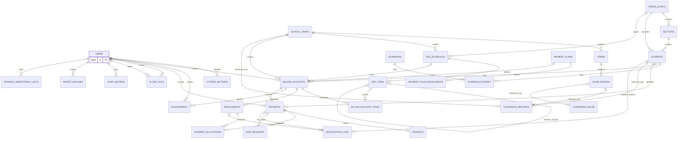

# Existing-schema ERD — descriptive draft

**Status:** Descriptive reconstruction of the Laravel migration baseline. **Not approved as a future design.** Source of executable schema remains the ordered migrations in `backend/database/migrations/`. This diagram covers the 30 EducaTrak domain tables; Laravel support tables are listed separately below.

### Notes and omitted framework tables

- `students.student_no` is the current unique business identifier. No LRN column exists. Owner approved Student Number-to-LRN only for separately authorized future work; no semantics or schema change is approved here.
- `billing_account_items` preserve name/category/amount snapshots; linked `fee_item_id` is nullable. Fee revisions create versions; existing account snapshots remain unchanged and revised schedules apply to new accounts only.
- `audit_entries.entity_type` plus string `entity_id` is a polymorphic reference, not a numeric foreign key. `before` and `after` JSON are nullable; database immutability is not enforced by these migrations.
- `clearance_rules` and `clearance_records` remain historical schema. Active clearance and exam permit flows are retired by the November 5 decision.
- `receipt_sequences` is a singleton-style sequence row seeded by migration; its key has no check constraint enforcing only `id = 1`.
- Laravel support tables are `users`, `password_reset_tokens`, `sessions`, `cache`, `cache_locks`, `jobs`, `job_batches`, and `failed_jobs`. `users` appears only as a key-only entity to show its domain foreign keys; other support tables are omitted from the domain relationship drawing.
- Diagram source: migration declarations, not a live database export. It has not been regenerated or validated against deployed MySQL.

### Approval boundary

This diagram describes current migration relationships only. It does not approve a new schema, settle guardian ownership, global deletion policy, retention, current-school-year uniqueness, or LRN migration. B7 remains skipped pending owner approval and safe matching-engine checks.
