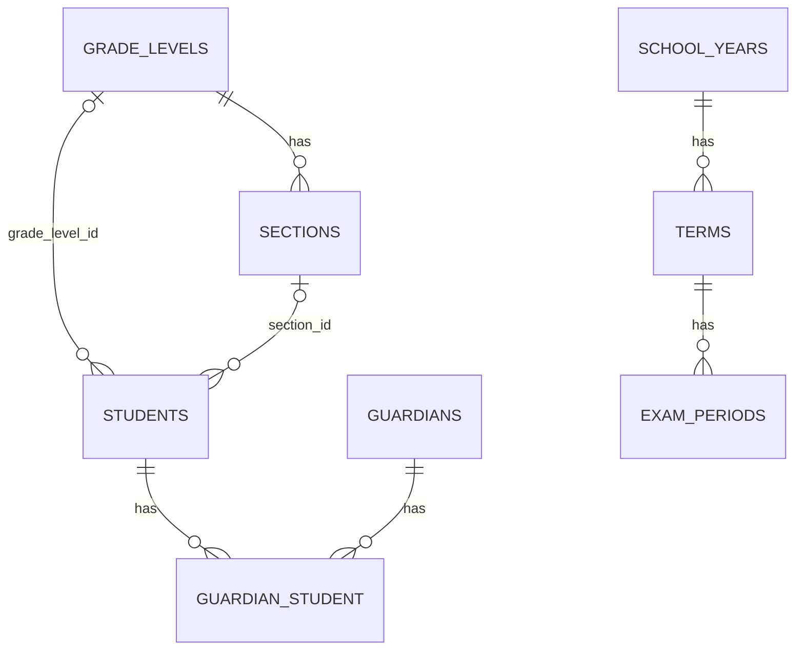
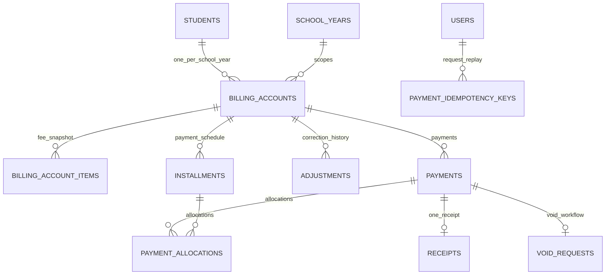
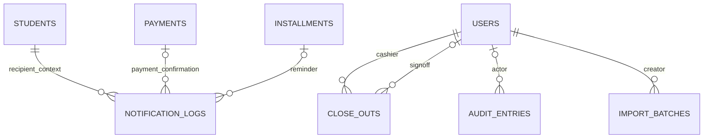
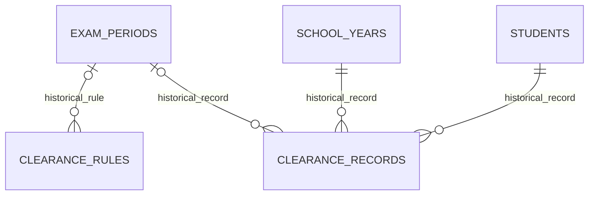

# EducaTrak database ERD

**Status:** migration-derived description of the executable schema at `feature/backend-foundation` / `124a78637e36ee91fd0b3a126813b5a394305ab6`. The ordered Laravel migrations in `backend/database/migrations/` remain the executable source of truth. This document does not authorize a migration, a data operation, or a future schema.

## Canonical relationship diagram

The canonical diagram includes every application-domain table and its declared foreign-key relationship. `audit_entries.entity_type` + `entity_id` is deliberately not drawn as an FK because it is polymorphic text identity. Framework support tables are summarized below.

```mermaid
erDiagram
    USERS o|--o{ USERS : archived_by
    USERS o|--o{ SYSTEM_SETTINGS : updated_by
    USERS ||--o{ BILLING_ACCOUNTS : created_by
    USERS ||--o{ ADJUSTMENTS : created_by
    USERS ||--o{ PAYMENTS : recorded_by
    USERS o|--o{ VOID_REQUESTS : decided_by
    USERS ||--o{ VOID_REQUESTS : requested_by
    USERS ||--o{ CLOSE_OUTS : cashier
    USERS o|--o{ CLOSE_OUTS : signed_off_by
    USERS o|--o{ AUDIT_ENTRIES : user_id
    USERS ||--o{ IMPORT_BATCHES : created_by
    USERS ||--o{ PAYMENT_IDEMPOTENCY_KEYS : user_id

    SCHOOL_YEARS ||--o{ TERMS : contains
    TERMS ||--o{ EXAM_PERIODS : contains
    GRADE_LEVELS ||--o{ SECTIONS : contains
    GRADE_LEVELS o|--o{ STUDENTS : classifies
    SECTIONS o|--o{ STUDENTS : assigns
    STUDENTS ||--o{ GUARDIAN_STUDENT : links
    GUARDIANS ||--o{ GUARDIAN_STUDENT : links
    SCHOOL_YEARS ||--o{ FEE_SCHEDULES : scopes
    GRADE_LEVELS ||--o{ FEE_SCHEDULES : scopes
    FEE_SCHEDULES ||--o{ FEE_ITEMS : defines
    FEE_ITEMS o|--o{ FEE_ITEMS : previous_version
    PAYMENT_PLANS ||--o{ PAYMENT_PLAN_INSTALLMENTS : defines

    STUDENTS ||--o{ BILLING_ACCOUNTS : owns
    SCHOOL_YEARS ||--o{ BILLING_ACCOUNTS : scopes
    FEE_SCHEDULES o|--o{ BILLING_ACCOUNTS : source_schedule
    PAYMENT_PLANS o|--o{ BILLING_ACCOUNTS : source_plan
    BILLING_ACCOUNTS ||--o{ BILLING_ACCOUNT_ITEMS : snapshots
    FEE_ITEMS o|--o{ BILLING_ACCOUNT_ITEMS : source_item
    BILLING_ACCOUNTS ||--o{ INSTALLMENTS : schedules
    BILLING_ACCOUNTS ||--o{ ADJUSTMENTS : corrects
    BILLING_ACCOUNTS ||--o{ PAYMENTS : receives
    STUDENTS ||--o{ PAYMENTS : denormalized_identity
    PAYMENTS ||--o| RECEIPTS : issues
    PAYMENTS ||--o{ PAYMENT_ALLOCATIONS : allocates
    INSTALLMENTS ||--o{ PAYMENT_ALLOCATIONS : receives
    PAYMENTS ||--o| VOID_REQUESTS : may_have
    STUDENTS ||--o{ NOTIFICATION_LOGS : contact_context
    PAYMENTS o|--o{ NOTIFICATION_LOGS : payment_context
    INSTALLMENTS o|--o{ NOTIFICATION_LOGS : installment_context

    EXAM_PERIODS o|--o{ CLEARANCE_RULES : historical_only
    STUDENTS ||--o{ CLEARANCE_RECORDS : historical_only
    SCHOOL_YEARS ||--o{ CLEARANCE_RECORDS : historical_only
    EXAM_PERIODS o|--o{ CLEARANCE_RECORDS : historical_only

    RECEIPT_SEQUENCES {
        tinyint id PK
        bigint last_sequence
    }
    BACKUP_RECORDS {
        bigint id PK
        varchar result
        bigint size_bytes
        timestamp completed_at
    }
```

## People and academic structure

`students.lrn` is an exact 12-character string in the schema and is unique. `guardian_student.relationship` is nullable and link-specific; the older required `guardians.relationship` column still exists. The migration backfilled the new pivot value from the old guardian-wide value without deleting either field. The current student writer stores a new guardian's validated relationship in both fields as a compatibility mirror, then preserves the legacy field when later changing that student's link relationship.

## Billing, payment, and receipt integrity

The database declares one billing account per `(student_id, school_year_id)`, one receipt per payment, one allocation per `(payment_id, installment_id)`, one void request per payment, globally unique receipt sequence/number, and user-scoped idempotency keys. Financial values are integer centavos; no migration declares a floating-point money column.

## Notifications, operations, and evidence

`notification_logs.delivery_key` is nullable but unique when populated; `provider_message_sid` is indexed. `close_outs.system_totals` is a JSON snapshot. `audit_entries` has declared user attribution but no database foreign key for its polymorphic entity identity and no database append-only control.

## Historical-only clearance and support tables

`clearance_rules` and `clearance_records` are retained historical entities. There are no active clearance or exam-permit API routes in `backend/routes/api.php`; they must not be treated as current workflows or destructively removed without a separately approved preservation plan.

## Framework tables and boundaries

Laravel support migrations create `users`, `password_reset_tokens`, `sessions`, `cache`, `cache_locks`, `jobs`, `job_batches`, and `failed_jobs`. They are intentionally omitted from the domain diagrams except `users`, which is shown because domain tables reference it.

Declared restrictive foreign keys preserve important relationships, but they are not a global immutability mechanism. In particular, the schema does not prevent direct updates/deletes to payments, receipts, notification logs, or audit rows; the no-hard-delete and append-only requirements depend on application controls, database privileges, and an approved retention policy.

## Current schema versus approved target

| Topic | Executable now | Approved future target / limit |
|---|---|---|
| Student identifier | Unique `students.lrn VARCHAR(12)`; API validation requires exactly 12 digits. | No LRN migration is pending in this branch; preservation of existing IDs and linked records remains mandatory. |
| Guardian relationship | Nullable `guardian_student.relationship` is the link-specific API field; legacy `guardians.relationship` remains required. | SYNC-GDN-01 makes each student create/update plus optional guardian/link write and audit record atomic. A newly created guardian receives the validated relationship as a compatibility mirror; a later link update does not overwrite that guardian-wide legacy value. Guardian ownership/lifecycle remains unresolved. |
| Current school year | `is_current` is indexed, not unique; dashboard rejects zero or multiple current rows with HTTP 409. | Exactly-one policy is accepted in behavior but needs management API and database-enforcement design. |
| Fee changes | Fee versions and account-item snapshots exist. A new fee is copied to every existing account using its schedule, increments total due/balance, creates one unpaid installment, and immediately recalculates the installment/account status; the response reports the number of accounts updated. Versions retain previously assigned snapshots. An all-grade revision synchronizes only schedules where the fee did not already exist. | Isolated SQLite feature evidence covers the behavior, including a formerly paid account becoming due soon after a same-day fee. Matching-MySQL transaction/lock and rollback evidence remains required before release. |
| Clearance / permits | Historical tables only. | Retired as active workflows. |
| Imports | `import_batches` persists a generic batch shape. | No live student-import route, parser, apply path, or retention contract. |

Do not use this ERD as DDL or as approval to alter a database.
