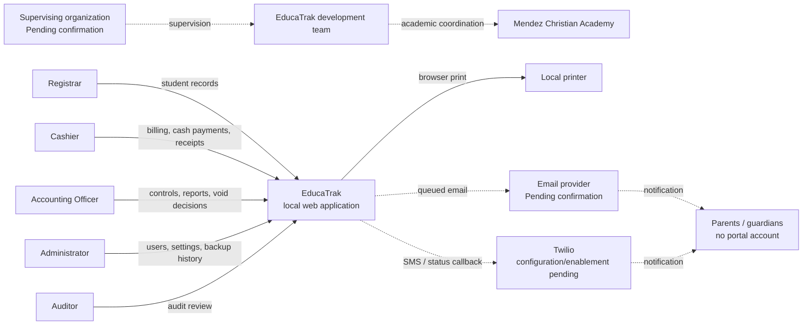

# Figure 1 — External Interface Diagram

## 1. Purpose and Project Plan Placement

Place in **2.1 External Interfaces**. Show organizational relationships separately from technical data exchanges. **Approved Requirement:** no parent/guardian portal or account is implied.

## 2. Scope and System Boundaries

EducaTrak is the local web application used by authorized staff on one existing office computer. The supervising/parent organization is **Pending Confirmation**; Mendez Christian Academy is the beneficiary institution. Email/SMS need external connectivity and are not proven operational.

## 3. Verified Repository Sources

`backend/routes/api.php`; `backend/app/Support/CapabilityMap.php`; `backend/app/Http/Controllers/Api/ReminderDeliveryController.php`; `backend/app/Http/Controllers/Api/PaymentController.php`; `06-Decisions/2026-11-05-student-record-role-reassignment.md`; `06-Decisions/Reconciled-Decisions.md`.

## 4. Actors, Interfaces, and Connections

| Origin | Destination | Purpose / exchanged information | Type | Classification / evidence |
|---|---|---|---|---|
| Development team | EducaTrak project | Design, build, test, document | Manual organizational | Approved project-owner context |
| Supervising organization | Development team | Academic supervision | Manual organizational | Pending Confirmation; no named organization in repository |
| Mendez Christian Academy | EducaTrak | Beneficiary school; operational requirements | Manual organizational | Approved Requirement |
| Registrar | EducaTrak | Student record maintenance; LRN, academic and authorized contact context | Direct application | Verified `students.manage` |
| Cashier | EducaTrak | Billing accounts, cash payments, receipts, void requests, close-outs | Direct application | Verified capability map/routes |
| Accounting Officer | EducaTrak | Finance settings, void decisions, reports, sign-off | Direct application | Verified capability map/routes |
| Administrator | EducaTrak | Users, system settings, security events, backup history | Direct application | Verified capability map/routes |
| Auditor | EducaTrak | Read-only audit review | Direct application | Verified `audit.view` |
| Guardian / parent | Email/SMS service | Receipt/reminder recipient data | External service | Approved scope; passive recipient only |
| EducaTrak | Local printer | User-initiated receipt/report output | Direct application / local device | Documented Design; browser print UI, no printer integration found |
| EducaTrak | Email provider | Queued receipt/reminder email | External service | Code-backed queue/log; provider Pending Confirmation |
| EducaTrak | Twilio | SMS reminder submission/status callback | External service | Verified controller integration; operation disabled until config/approval |
| Registrar | Student masterlist file | CSV/XLSX selection | File transfer | Approved bounded UI; parsing/apply not implemented |
| Authorized import user | Financial ledger file | Ledger import | File transfer | Approved scope but no granted capability/backend implementation |

## 5. Relationships and Diagram Construction Instructions

Draw a solid box for EducaTrak. Put staff on the left, the local printer beneath it, external providers/guardians on the right, and organizations above. Use solid arrows for direct app use, dashed arrows for manual organization relationships, and dotted arrows for pending/external services. Annotate guardian arrows “notification recipient — no portal.”

## 6. Diagram Source

## 7. Verification and Accuracy Checklist

- [x] Operational roles reflect the backend capability map.
- [x] Clearance/permit interfaces excluded.
- [x] No parent portal or direct parent-to-app association.
- [x] Provider and printer status distinguished from working integration.

## 8. Outstanding Decisions and Limitations

Confirm the supervising organization, email provider, live network policy, printer configuration, and financial-ledger-import owner. Older documents state an intranet/no-external-network deployment; the current task’s single-computer design governs this figure.

## 9. Change History

- November 15, 2026 — Created from current decisions and route/controller evidence.
