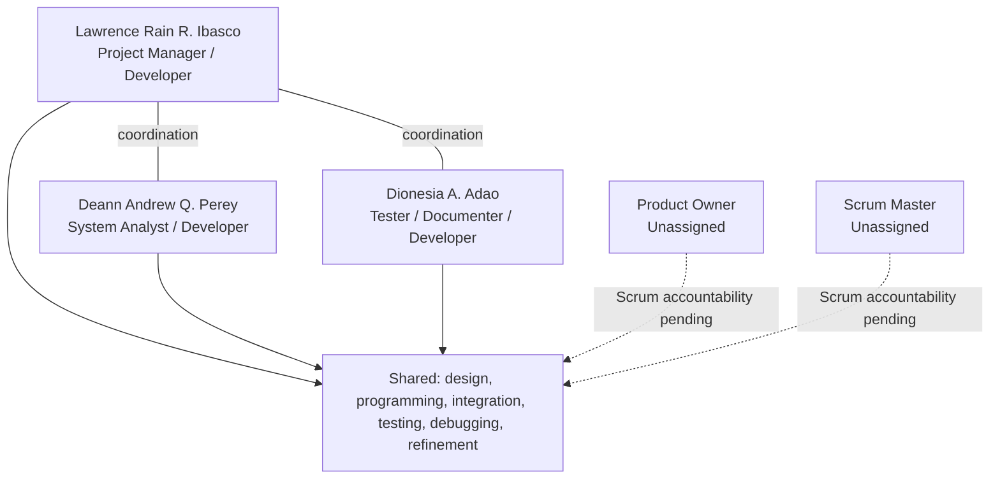

# Figure 2 — Internal Organizational Structure

## 1. Purpose and Project Plan Placement

Place in **2.2 Internal Structure**. This describes the academic development team, not the school’s operational authorization hierarchy.

## 2. Scope and Sources

**Approved project-owner context:** Lawrence Rain R. Ibasco is Project Manager / Developer; Deann Andrew Q. Perey is System Analyst / Developer; Dionesia A. Adao is Tester / Documenter / Developer. All three share design, programming, integration, testing, debugging, and refinement. Product Owner and Scrum Master are **Pending Confirmation**.

## 3. Diagram Construction Instructions

Use one coordination line from Project Manager / Developer to the two peer specialist roles; place a common “shared development accountability” band beneath all three. Do not show Product Owner or Scrum Master as assigned positions. Use a note, not a reporting line, for their unassigned Scrum accountabilities.

## 4. Diagram Source

## 5. Verification and Accuracy Checklist

- [x] Contains only the three named academic roles.
- [x] Separates academic titles from unassigned Scrum accountabilities.
- [x] Does not infer school-user permissions from team titles.

## 6. Outstanding Decisions and Limitations

The repository does not record a supervising manager, Product Owner, or Scrum Master. Confirm these only if the project owner formally assigns them.

## 7. Change History

- November 15, 2026 — Created from current task context.
