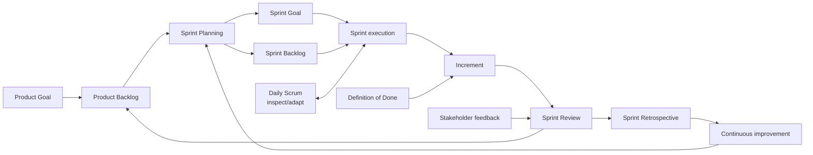

# Figure 3 — Agile Scrum Framework

## 1. Purpose and Project Plan Placement

Place in **4.1 Theoretical Framework**. This is a conceptual Scrum reference, not evidence of completed Sprints, cadence, or assigned Scrum accountabilities.

## 2. Scope and Sources

**Documented Design:** Agile/Scrum is the stated methodology. Use the Scrum Guide concepts (events, artifacts, commitments) only as a conceptual reference. No repository source establishes sprint length, ceremony frequency, Product Owner, Scrum Master, or outcomes.

## 3. Elements and Relationships

| Category | Element | Relationship |
|---|---|---|
| Artifact / commitment | Product Backlog / Product Goal | Product Goal describes long-term objective; backlog is ordered work toward it. |
| Event / commitment | Sprint Planning / Sprint Goal / Sprint Backlog | Planning creates the Sprint Goal and actionable selected work. |
| Event | Sprint execution / Daily Scrum | Daily Scrum supports inspection/adaptation of progress toward Sprint Goal. |
| Artifact / commitment | Increment / Definition of Done | A usable Increment must meet the Definition of Done. |
| Events | Sprint Review / Retrospective | Review gains stakeholder feedback; Retrospective improves future work. |

## 4. Diagram Source

## 5. Diagram Construction Instructions

Use a circular left-to-right layout. Label only “Daily Scrum” as an event inside the Sprint; do not depict it as a separate delivery phase. Keep Product Goal/Sprint Goal/Definition of Done visually tied to their respective artifacts.

## 6. Verification and Accuracy Checklist

- [x] No sprint duration, schedule, named assignee, or delivered increment claimed.
- [x] Distinguishes events, artifacts, and commitments.
- [x] Shows iterative feedback and improvement.

## 7. Outstanding Decisions and Limitations

Product Goal wording and formal Scrum accountabilities remain pending. Do not populate these from academic titles.

## 8. Change History

- November 15, 2026 — Created as methodology reference.
