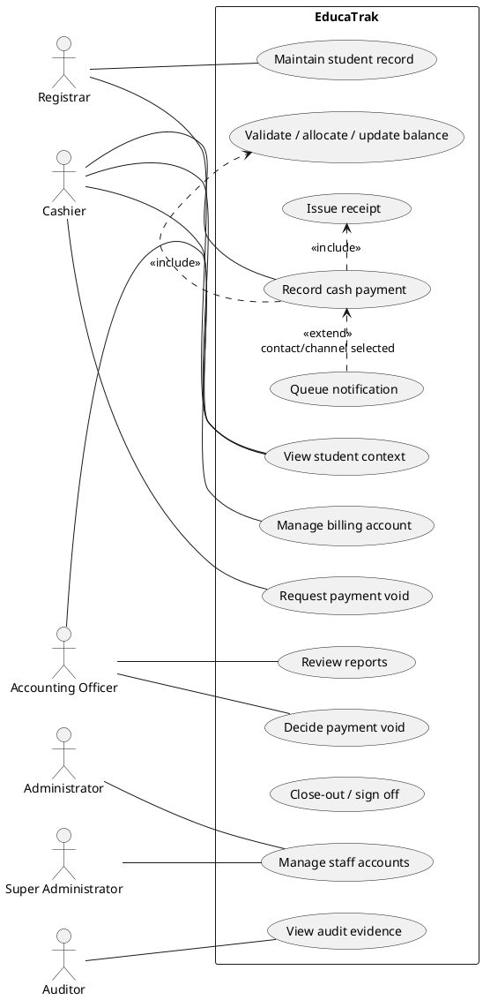

# Figure 4 — UML Use-Case Diagram

## 1. Purpose and Project Plan Placement

Place in **5.1 or 5.3**. The use cases below reconcile backend `CapabilityMap`, route middleware, controllers, and approved requirements. “Implemented” means a code-backed route/action was found, not that deployment acceptance occurred.

## 2. Actors and System Boundary

Direct actors: Super Administrator, Administrator, Registrar, Cashier, Accounting Officer, Auditor. Parents/guardians are passive notification recipients, not UML actors with system access. Keep retired clearance and exam-permit use cases outside the system boundary.

## 3. Verified Repository Sources

`backend/app/Support/CapabilityMap.php`; `backend/routes/api.php`; `frontend/src/App.tsx`; `backend/app/Actions/{RecordPaymentAction,RequestVoidAction,DecideVoidRequestAction,SubmitCloseOutAction}.php`; `06-Decisions/2026-11-05-student-record-role-reassignment.md`; `06-Decisions/2026-11-07-student-masterlist-import.md`.

## 4. Use-Case Catalogue

| ID | Use case | Primary actor | Supporting actor | Preconditions / successful outcome | Permission / status / evidence |
|---|---|---|---|---|---|
| UC-01 | Authenticate and change password | All staff | — | Active account; session/profile issued or password changed | Implemented: auth routes |
| UC-02 | Manage staff accounts | Super Administrator, Administrator | — | Authorized manager creates, archives, restores, resets or updates permitted accounts | `users.manage`; implemented |
| UC-03 | Maintain student record | Registrar | — | Authenticated; creates/updates approved basic record; LRN is retained/validated | `students.manage`; implemented API; masterlist phase is separate |
| UC-04 | View student context | Registrar, Cashier, Accounting | — | Authorized role reads allowed student/financial/contact context | `students.view` etc.; implemented |
| UC-05 | Manage billing account / adjustment | Cashier | — | Student/account context exists; authorized account change is recorded | `accounts.manage`; implemented route/controller |
| UC-06 | Configure finance settings | Accounting Officer | — | Authorized finance setting change/version operation succeeds | `settings.finance.manage`; implemented fee-item routes |
| UC-07 | Record cash payment | Cashier | System | Valid current billing account; atomic payment, allocation, balance update and receipt result | `payments.record`; implemented |
| UC-08 | Reprint receipt | Cashier, Accounting | Local printer | Authorized payment visible; printable receipt returned and evidence updated | `receipts.reprint`; implemented API; physical print unverified |
| UC-09 | Request payment void | Cashier | Accounting Officer | Valid payment; request becomes pending | `void.request`; implemented |
| UC-10 | Decide payment void | Accounting Officer | System | Pending request not recorded by decider; approve reverses allocation/balance or reject restores valid | `void.approve`; implemented |
| UC-11 | Review reports and statements | Accounting Officer | — | Authorized finance data is returned | `reports.view`; implemented routes |
| UC-12 | Submit / sign off close-out | Cashier / Accounting Officer | — | Cashier submits; Accounting signs off | `closeout.submit` / `closeout.signoff`; implemented |
| UC-13 | View audit evidence | Auditor, Super Administrator | — | Authorized read-only audit information displayed | `audit.view`; implemented |
| UC-14 | Review backup history | Administrator | — | Backup-record history displayed | `backup.manage`; implemented history only |
| UC-15 | Select student masterlist file | Registrar | — | CSV/XLSX selected; no data parsed/applied | frontend `student.edit`; implemented bounded UI |
| UC-16 | Import financial ledger | No currently authorized role | — | N/A | Approved scope, **not implemented**; `import.run` granted to none |
| UC-17 | Send/retry payment reminders | Cashier, Accounting | Email/SMS provider | Eligible contact and policy/provider enablement; delivery log created | implemented code, operationally fail-closed |

## 5. Relationships and Diagram Construction Instructions

Draw each actor only to its direct use cases. Show `Record cash payment` **include** `Validate payment`, `Allocate installments`, `Update account balance`, and `Issue receipt` because these are unconditional inside the transaction. Show `Queue notification` as an **extend** conditionally triggered by selected channel/contact, not a completed delivery claim. Show `Request payment void` then `Decide payment void` as sequentially related use cases, not include/extend. Do not connect ledger import to any actor while its authorization is unassigned.

## 6. Diagram Source (construction-ready PlantUML)

## 7. Verification and Accuracy Checklist

- [x] Actor permissions derive from backend authorization, not old role prose.
- [x] Payment/void flows match transactional action classes.
- [x] Retired clearance and permit use cases excluded.
- [x] Masterlist and ledger import are separately classified.

## 8. Outstanding Decisions and Limitations

The exact financial-ledger-import owner, provider readiness, guardian-data ownership, and production deployment acceptance are pending. Frontend MockDB uses client-side capability labels; backend remains the security boundary.

## 9. Change History

- November 15, 2026 — Created from current route, capability, action, and decision evidence.
