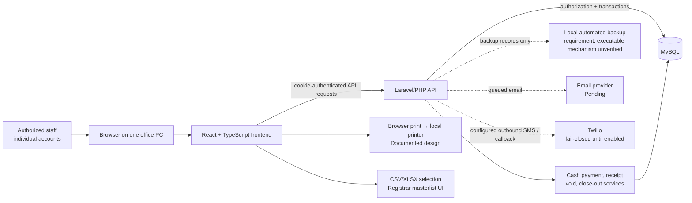

# Figure 5 — System Architecture Diagram

## 1. Purpose and Project Plan Placement

Place in **5.3 System Overview**. It deliberately separates code that exists from approved deployment or integration requirements.

## 2. Scope and System Boundaries

**Approved Requirement:** one existing office computer hosts/runs the locally hosted, browser-based application; staff use individual role-based accounts. This supersedes older descriptions of a multi-computer LAN/no-external-network runtime. Internet connectivity is a dependency for email/SMS, not an established deployment fact.

## 3. Verified Repository Sources

`frontend/package.json`, `frontend/src/App.tsx`, `backend/routes/api.php`, `backend/app/Http/Middleware/{EnsureActiveUser,EnsureCapability}.php`, `backend/app/Support/CapabilityMap.php`, `backend/database/migrations/`, `backend/app/Http/Controllers/Api/{PaymentController,BackupController,ReminderDeliveryController}.php`, `backend/routes/console.php`.

## 4. Components and Connections

| Component | Responsibility | Hosting / boundary | Direction / status |
|---|---|---|---|
| Authorized staff browser | User interface and session use | Single office computer; staff authentication boundary | Browser → frontend/API; **Approved Requirement** |
| React/TypeScript frontend | Routes, forms, presentation, API adapter | Local application runtime; client-side UX guards only | Browser ↔ API; **Verified Implementation** |
| Laravel/PHP API | Session auth, capability enforcement, business actions | Local app server; server authorization boundary | API ↔ MySQL; **Verified Implementation** |
| MySQL database | Persistent domain, audit, configuration records | Local persistence boundary | Laravel ↔ database; **Approved Requirement** plus schema evidence |
| Cash-payment/receipt services | Validate payment, allocate installments, update balances, issue receipts | Laravel transaction | API → database; **Verified** `RecordPaymentAction` |
| Local printer | User-triggered receipt/report output | Connected local device | Browser print; **Documented Design** |
| Backup mechanism | Automated local database backup | Local operations boundary | **Approved Requirement; not verified executable**: only history table/API found |
| Email service | Receipt/reminder delivery | External network boundary | **Code-backed, provider Pending Confirmation** |
| Twilio | SMS reminders/status callback | External network boundary | **Code-backed, disabled until configuration/policy** |
| File selection | Student masterlist CSV/XLSX selection; future ledger import | Browser file boundary | Student UI verified bounded; ledger import pending |

## 5. Diagram Source

## 6. Diagram Construction Instructions

Draw a heavy local boundary around browser, frontend, Laravel, MySQL, printer and backup. Place email/Twilio outside it with dotted dependency arrows labeled “requires external connectivity.” Mark the frontend authorization check “UX only” and Laravel middleware “security boundary.” Never show parent devices, a parent portal, or a confirmed distributed intranet.

## 7. Verification and Accuracy Checklist

- [x] Stack and backend routes inspected.
- [x] Capability enforcement resides server-side in route middleware.
- [x] Backup record/history is not misrepresented as an executable backup.
- [x] Email and SMS distinguished from successful delivery.
- [x] Retired clearance removed.

## 8. Outstanding Decisions and Limitations

Confirm exact MySQL version, local process topology, backup command/schedule/restore testing, provider/email configuration, external connectivity, TLS/origin, printer setup, and ledger-import implementation. `routes/console.php` schedules billing-status recalculation and archive anonymization; it does not schedule a database backup.

## 9. Change History

- November 15, 2026 — Created from current source and superseding deployment instruction.
