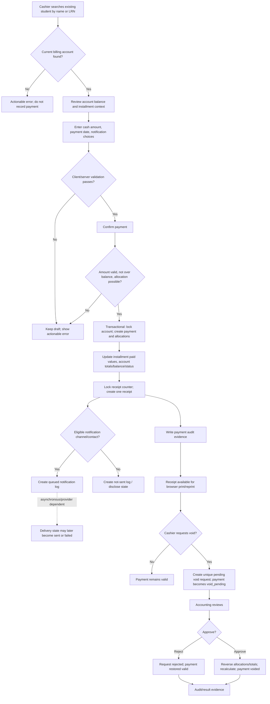

# Figure 7 — System Workflow / Activity Diagram

## 1. Purpose and Project Plan Placement

Place in **5.3 System Overview**. Each workflow below identifies code-backed behavior separately from approved, bounded, or unimplemented work.

## 2. Verified Repository Sources

`backend/app/Actions/{RecordPaymentAction,RequestVoidAction,DecideVoidRequestAction,SubmitCloseOutAction}.php`; `backend/app/Http/Controllers/Api/{PaymentController,ReminderDeliveryController,CloseOutController}.php`; `backend/routes/api.php`; `frontend/src/features/{operations/LivePaymentEntryPage.tsx,students/StudentImportPage.tsx}`; approved November 5/7 decisions.

## 3. Main Cash Payment and Void Workflow

**Actors:** Cashier, system, Accounting Officer. **Status:** payment/void paths are **Verified Implementation**; actual printer/provider delivery is not verified.

**Decision detail:** an amount must be positive, no greater than balance, and fully allocable. Same student/same amount within ten minutes needs an override reason. A back-dated payment needs a reason; a recorder cannot decide their own void request. These application rules are in `RecordPaymentAction`, `StorePaymentRequest`, and `DecideVoidRequestAction`.

## 4. Independent Supporting Workflows

| Workflow | Verified path | Negative/result path | Classification |
|---|---|---|---|
| Student masterlist | Registrar opens `/students/import`, selects `.csv`/`.xlsx` | Wrong type/empty file reports error; valid selection does **not** parse, preview, reconcile, or write | Bounded Phase 1 UI |
| Financial ledger import | `/import` frontend placeholder route exists | `import.run` is granted to no role; no backend endpoint found | Approved scope, not implemented |
| Reminder delivery | Eligible reminder requests create log then call email/Twilio if feature enabled | Disabled policy returns 503; missing contact becomes `not_sent`; uncertain response remains queued; provider failure becomes failed | Code-backed but operationally fail-closed |
| Cashier close-out | Cashier enters counted cash; system totals cash; variance requires reason | Existing business-date close-out returns locked error | Verified API/action |
| Accounting sign-off | Accounting signs an unsigned close-out | Already signed-off returns error | Verified API/controller |
| Backup | Administrator can read backup history | No executable backup trigger/job discovered | Requirement + history interface, execution unverified |

## 5. Diagram Construction Instructions

Use swimlanes: Cashier, EducaTrak/Laravel, Accounting Officer, and External Provider. Show notification arrows as dashed asynchronous work; do not draw backup or import as prerequisite steps in payment processing. In the final activity diagram, retain both outputs of every diamond above.

## 6. Business Rules and Constraints

Cash is the payment method created by `RecordPaymentAction`; `payments.method` nonetheless remains a configurable string in the schema. Receipt sequencing is generated in the transaction. Approved void reversals alter account/installment figures only after Accounting approval. Close-out uses valid cash payments for the selected business date. The system logs notification attempts but does not prove successful external delivery on queueing.

## 7. Verification and Accuracy Checklist

- [x] Main payment/void action behavior checked against code.
- [x] Independent import, backup and notification workflows not collapsed into payment sequence.
- [x] Positive and negative decision outcomes shown.
- [x] Retired clearance/permit work absent.

## 8. Outstanding Decisions and Limitations

Guardian ownership, masterlist later phases, ledger-import authorization/implementation, provider enablement, backup/restore mechanism and physical print verification remain pending. No current route proves a shareable PDF download; receipt rendering/printing is code-backed but a separate PDF artifact is not confirmed.

## 9. Change History

- November 15, 2026 — Created from current action/controller/UI evidence.
