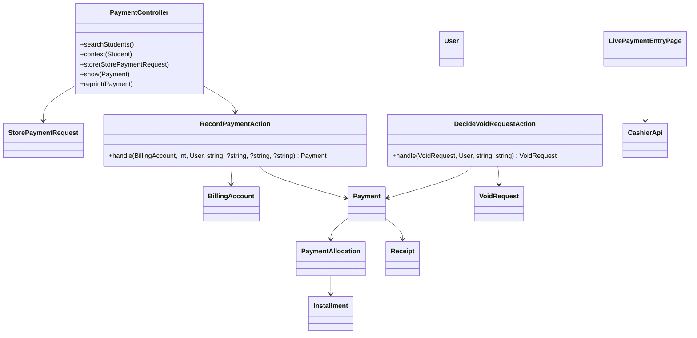

# Figure 9 — UML Class Diagram Reference

## 1. Purpose and Project Plan Placement

Supplementary software-design reference. This is a selected domain-focused class diagram, intentionally not a diagram of every Laravel framework class. A physical ERD is schema/constraint oriented; this class view shows code responsibilities and object collaborations.

## 2. Scope and System Boundaries

The diagram covers the cash-payment/receipt/void collaboration and its frontend caller. It excludes retired clearance/permit classes, framework internals, and classes whose associations cannot be established from source. It makes no claim that every model relationship has an explicit Eloquent method.

## 3. Verified Repository Sources

`backend/app/Models/{BillingAccount,Payment,Receipt,VoidRequest,Student,User}.php`; `backend/app/Actions/{RecordPaymentAction,RequestVoidAction,DecideVoidRequestAction,RecalculateBillingStatusAction}.php`; `backend/app/Http/Controllers/Api/{PaymentController,StudentController,VoidRequestController}.php`; `backend/app/Http/Requests/{StorePaymentRequest,UpsertStudentRequest,StoreVoidRequestRequest,DecideVoidRequestRequest}.php`; `frontend/src/api/cashierApi.ts`; `frontend/src/features/operations/LivePaymentEntryPage.tsx`.

## 4. Classes, Roles, and Important Members

| Kind | Class / type | Verified responsibility / members |
|---|---|---|
| Eloquent model | `BillingAccount` | Persistent account; explicit `installments()` and `payments()` relations. |
| Eloquent model | `Payment` | Persistent payment; explicit `allocations()` relation; linked receipt/void behavior is used by controllers/actions. |
| Eloquent models | `Student`, `Receipt`, `VoidRequest`, `Installment`, `PaymentAllocation`, `User` | Persist schema-backed domain records. Do not invent relationship methods absent from model sources. |
| Action service | `RecordPaymentAction` | `handle(account, amountCents, recordedBy, paidOn, notes, backdateReason, duplicateOverrideReason): Payment`. |
| Action service | `RequestVoidAction` | Creates pending request and payment status change. |
| Action service | `DecideVoidRequestAction` | `handle(voidRequest, decidedBy, decision, note): VoidRequest`; reverses approved payment impact. |
| Controller | `PaymentController` | Search/context/index/store/show/reprint endpoints; orchestrates requests/actions/audit. |
| Request | `StorePaymentRequest` | Validates idempotency header, account, integer centavos, date, explanatory fields, channels. |
| Frontend type/component | `PaymentStudent`, payment-context/result types; `LivePaymentEntryPage` | Renders search, form/review/success and calls cashier API. |

## 5. Diagram Source

## 6. Associations and Construction Instructions

Use dependency arrows for Controller → Request/Action and action → models. Use associations only where source/migration behavior supports a domain link. Add a note: “Some physical FKs do not have explicit Eloquent relation methods in this branch.” Do not claim inheritance beyond framework-provided base classes unless source explicitly shows it.

## 7. Physical ERD Difference

The ERD documents exact table names, keys, nullability, unique indexes and referential actions. This diagram documents PHP/TypeScript responsibilities. For example, `receipt.payment_id` is a unique database FK even if the inspected `Payment` source does not declare a visible `receipt()` method; `RecordPaymentAction` enforces transaction behavior that the DDL does not fully express.

## 8. Verification and Accuracy Checklist

- [x] Only selected classes with source evidence included.
- [x] Explicitly avoids inferring missing model methods.
- [x] Separates controller/request/action/frontend roles.
- [x] Retired clearance classes excluded.

## 9. Outstanding Decisions and Limitations

The database review identifies incomplete model relationship declarations. Add further classes only when an implementation/design source supports their members and associations. No proposed conceptual class is represented as implemented.

## 10. Change History

- November 15, 2026 — Created selected source-grounded class reference.
