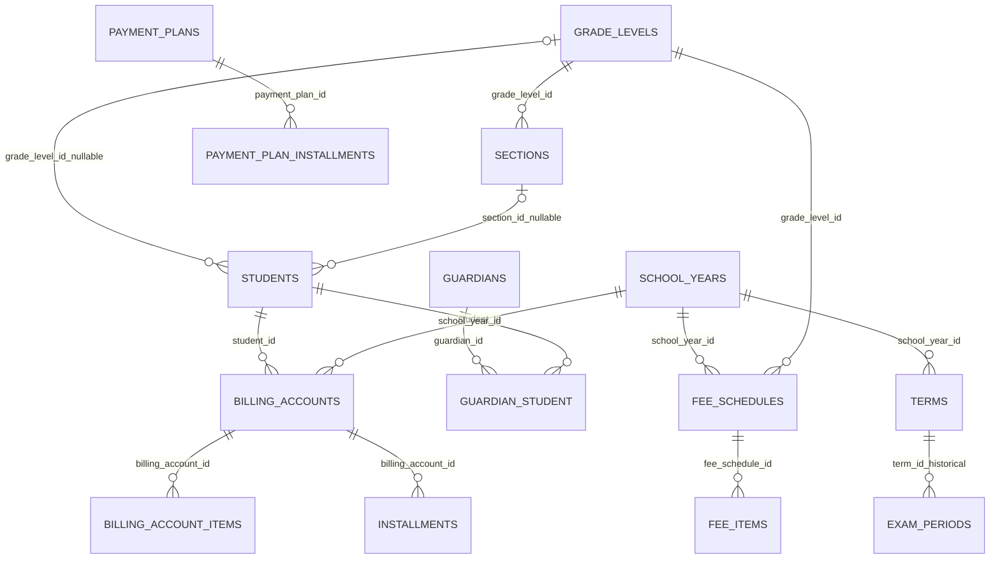

# Figure 6A — Student and Billing Domain ERD

## 1. Purpose and Project Plan Placement

Physical Crow’s Foot view for **5.3 System Overview**. Status: **Verified Implementation** from the reference/people and billing migrations, with later fee-item lifecycle additions.

## 2. Scope and Sources

Sources: `2026_10_09_062757_create_educatrak_reference_and_people_tables.php`, `2026_10_09_062759_create_educatrak_billing_tables.php`, `2026_10_24_205000_add_fee_item_lifecycle_and_versioning.php`. `exam_periods` is shown only as a retained historical dependency; it is not active plan scope.

## 3. Entity Data Dictionary

| Table (PK) | Purpose and important attributes (type; nullable where applicable) | FKs / unique / deletion action |
|---|---|---|
| `school_years` (`id`) | Academic period: `label string` unique; `is_current boolean` indexed; `starts_on date`; `ends_on date`; timestamps | No parent. `is_current` is not unique. |
| `terms` (`id`) | Retained academic subdivision: `name string`; `sequence unsignedSmallInteger`; optional start/end dates | `school_year_id` required → `school_years.id`, restrict; unique `(school_year_id, sequence)`. |
| `exam_periods` (`id`) | **Retired/Historical support**: name/start/end | `term_id` required → `terms.id`, restrict. |
| `grade_levels` (`id`) | Grade reference: `name string` unique; `sort_order unsignedSmallInteger` unique; `active boolean` | No FK. |
| `sections` (`id`) | Grade section: `name string`; `active boolean` | `grade_level_id` required → `grade_levels.id`, restrict; unique `(grade_level_id, name)`. |
| `students` (`id`) | Student: `lrn string(12)` unique; `full_name string`; `status string` indexed | Optional `grade_level_id`/`section_id` → parents, null-on-delete. `lrn` is not PK. |
| `guardians` (`id`) | Guardian contact: name/relationship strings; optional email indexed, email status, mobile string(32) | No FK. |
| `guardian_student` (`guardian_id`, `student_id`) | Student–guardian junction; `is_primary boolean`; timestamps | Both required, restrict; **composite PK** `(guardian_id, student_id)`. |
| `fee_schedules` (`id`) | Fee schedule name/active state | Required `school_year_id`, `grade_level_id` → parents, restrict; unique `(school_year_id, grade_level_id, name)`. |
| `fee_items` (`id`) | Schedule fee: name/category; `amount_cents unsignedBigInteger`; `required boolean`; sort order; later `active boolean`, `version unsignedInteger` | Required `fee_schedule_id` restrict; optional `previous_version_id` → `fee_items.id`, restrict. |
| `payment_plans` (`id`) | Plan: name unique; down-payment type/value; active flag | No school-year FK. |
| `payment_plan_installments` (`id`) | Plan installment: label, sequence, due-day offset, remaining-basis-points | Required `payment_plan_id` restrict; unique `(payment_plan_id, sequence)`. |
| `billing_accounts` (`id`) | Per-student/year financial account: status; `total_due_cents`, `total_paid_cents`, `balance_cents` unsigned; timestamps | Required student/year/creator FKs restrict; optional fee schedule/payment plan FKs null-on-delete; unique `(student_id, school_year_id)`. |
| `billing_account_items` (`id`) | Snapshot fee name/category/amount in account | Required `billing_account_id` restrict; optional `fee_item_id` null-on-delete. |
| `installments` (`id`) | Account schedule: label/sequence/due date, amount/paid cents, status | Required `billing_account_id` restrict; unique `(billing_account_id, sequence)`. |

`users.id` is an external required/restrict parent of `billing_accounts.created_by`; it is fully detailed in 6C.

## 4. Relationships and Cardinality

| Parent → child | Physical evidence | Cardinality / optionality |
|---|---|---|
| school year → terms | required `terms.school_year_id`, restrict | one → zero/many |
| term → exam periods | required `exam_periods.term_id`, restrict | one → zero/many (**historical**) |
| grade level → sections | required FK, restrict | one → zero/many |
| grade level / section → students | nullable FKs, null-on-delete | one → zero/many; each student → zero/one parent |
| guardian ↔ student | composite junction, two required restrict FKs | many ↔ many; each junction row requires one of each |
| school year / grade → fee schedules | required restrict FKs | one → zero/many |
| fee schedule → fee items | required restrict FK | one → zero/many |
| fee item → successor fee item | nullable self-FK, restrict | one → zero/one-or-many successors (no unique constraint on `previous_version_id`) |
| payment plan → plan installments | required restrict FK | one → zero/many |
| student / school year → billing account | required restrict FKs plus composite unique | each parent → zero/many; each student-year pair → zero/one account |
| fee schedule / payment plan → billing account | nullable FKs, null-on-delete | each account → zero/one reference; parent → zero/many |
| billing account → items / installments | required restrict FKs | one → zero/many |

## 5. Diagram Source

## 6. Business Rules and Constraints

LRN is a 12-character string column; exact 12-digit validation is application-level (`UpsertStudentRequest`), not a database check constraint. Guardian primary-contact uniqueness/ownership is not schema-enforced. Fee/account snapshots preserve historical item data; the database review notes policy work remains. All money here uses integer centavos.

## 7. Verification and Accuracy Checklist

- [x] Keys, FKs, nullability, uniqueness and delete actions taken from migrations.
- [x] Student–Guardian shown via composite-key junction.
- [x] No invented payment-plan/school-year relation.
- [x] Retired exam dependency labeled historical.

## 8. Outstanding Decisions and Limitations

Whether only one current school year may exist, who owns guardians, and whether one primary guardian is mandatory remain pending. Diagram tools should render nullable parent links as optional.

## 9. Change History

- November 15, 2026 — Created from inspected migrations.
