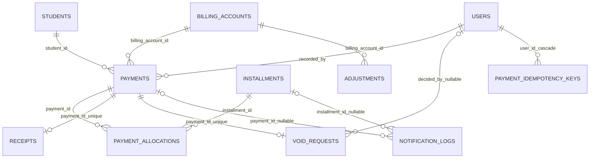

# Figure 6B — Payments and Financial Transactions ERD

## 1. Purpose and Project Plan Placement

Physical Crow’s Foot view for **5.3 System Overview**. Status: **Verified Implementation** from billing/operations migrations and payment/void actions. It represents persistence, not a claim that every external delivery or print succeeds.

## 2. Scope and Sources

Sources: `2026_10_09_062759_create_educatrak_billing_tables.php`; `2026_10_09_062801_create_educatrak_operations_tables.php`; `2026_10_22_203507_add_sms_fields_to_notification_logs_table.php`; `2026_10_24_183500_create_payment_idempotency_keys_table.php`; `2026_10_24_220000_create_receipt_sequences_table.php`; `2026_10_24_235600_add_first_printed_at_to_receipts_table.php`; `2026_10_25_130000_add_reminder_delivery_tracking.php`; payment/void actions.

## 3. Entity Data Dictionary

| Table (PK) | Purpose and important attributes | FKs / unique / deletion action |
|---|---|---|
| `payments` (`id`) | Cash payment: required account/student, `amount_cents unsignedBigInteger`, later optional `balance_after_cents`; `method string` default `cash`; date, optional reasons/notes; status indexed; recorder/time; reprint count | account/student/recorder required, restrict; indexes on `(student_id, amount_cents, recorded_at)` and `(billing_account_id, status)`. |
| `payment_allocations` (`id`) | Amount assigned from payment to installment; `amount_cents unsignedBigInteger` | required payment/installment, restrict; unique `(payment_id, installment_id)`. |
| `receipts` (`id`) | Issued receipt: `sequence unsignedInteger` unique; receipt number unique; year; issued time; optional `first_printed_at` | required **unique** `payment_id`, restrict: a payment → zero/one receipt. |
| `receipt_sequences` (`id`) | Single counter row: `id unsignedTinyInteger` PK; `last_sequence unsignedBigInteger` | No FK. Migration initializes row `id=1`; schema does not enforce exactly one row beyond PK values. |
| `void_requests` (`id`) | Void reason/requester/time/status; optional decision actor/time/note | required **unique** `payment_id` restrict; required requester restrict; optional decider null-on-delete. Payment → zero/one request. |
| `adjustments` (`id`) | Account adjustment: type; **signed** `amount_cents bigInteger`; reason; creator; effective time | required account/creator, restrict; index `(billing_account_id, effective_at)`. |
| `notification_logs` (`id`) | Payment/reminder notification metadata: student; optional payment/installment; recipient email/mobile; kind/status; attempts; optional sent time; channel indexed; optional SMS load fee; later delivery key/SID | student required restrict; payment/installment optional null-on-delete; `delivery_key` nullable unique; `provider_message_sid` indexed. |
| `payment_idempotency_keys` (`id`) | Per-user request replay record: key(100), request hash(64), optional response JSON/status/completion | `user_id` required, **cascade-on-delete**; unique `(user_id, key)`. |

`billing_accounts`, `installments`, `students`, `users` and `guardians` are coordinated external entities from 6A/6C.

## 4. Relationships and Cardinality

| Parent → child | Physical evidence | Cardinality / optionality |
|---|---|---|
| billing account → payments | `payments.billing_account_id` required, restrict | one → zero/many |
| student → payments / notification logs | required FKs, restrict | one → zero/many |
| user → payments / adjustments / void requesters | required FKs, restrict | one → zero/many |
| payment → allocations | required FK, restrict | one → zero/many |
| installment → allocations | required FK, restrict | one → zero/many |
| payment → receipt | unique required FK, restrict | one → zero/one; receipt → exactly one payment |
| payment → void request | unique required FK, restrict | one → zero/one; request → exactly one payment |
| user → void decisions | nullable `decided_by`, null-on-delete | user → zero/many; request → zero/one decider |
| billing account → adjustments | required FK, restrict | one → zero/many |
| payment / installment → notification logs | nullable FKs, null-on-delete | each log → zero/one of either reference; each parent → zero/many logs |
| user → idempotency keys | required FK, cascade | one → zero/many; deleting a user cascades only these rows |

## 5. Diagram Source

## 6. Business Rules and Constraints

`RecordPaymentAction` locks the account, blocks overpayment, detects same-student/same-amount recent payments unless overridden, allocates chronologically, updates balance/status, updates receipt sequence under lock, and creates the receipt transactionally. `RequestVoidAction` sets `void_pending`; `DecideVoidRequestAction` prevents the recorder from deciding and, when approved, reverses allocations/totals and sets payment `voided`. These are **Verified Implementation** application rules, not all database constraints. Notification `queued` means provider acceptance/delivery remains unconfirmed; actual delivery is separate.

## 7. Diagram Construction Instructions

Display `payment_id` on Receipts and Void Requests with a unique-key marker and use a zero-or-one crow’s foot outcome. Display signedness beside adjustments/variance only; do not render a direct Receipt–Sequence FK because none exists. Place notifications at the edge with optional Payment and Installment links; no FK to guardians exists.

## 8. Verification and Accuracy Checklist

- [x] Unique payment links correctly modeled as 1:0..1.
- [x] Integer-centavo/signed exception documented.
- [x] Notification delivery tracking and idempotency migration included.
- [x] Workflow assertions separated from DDL constraints.

## 9. Outstanding Decisions and Limitations

Provider configuration/operation remains pending. The schema does not enforce a payment allocation total, notification recipient ownership, immutable receipts/payments, or a single `receipt_sequences` row; application behavior should not be redrawn as DDL.

## 10. Change History

- November 15, 2026 — Created from current migrations and payment/void action evidence.
