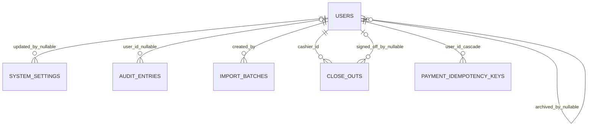

# Figure 6C — Operations and Configuration ERD

## 1. Purpose and Project Plan Placement

Physical operational/configuration view for **5.3 System Overview**. Status: **Verified Implementation** from migrations; operational completion remains separately classified.

## 2. Scope and Sources

Sources: users migration and later archive/protection migrations; operations migration; idempotency migration; Laravel cache/job migrations. See 6A/6B for finance-linked entities.

## 3. Entity Data Dictionary

| Table (PK) | Purpose and important attributes | FKs / unique / deletion action |
|---|---|---|
| `users` (`id`) | Staff account: username unique; full name; optional email unique; role indexed; active/protected flags; password/session fields; optional archive/anonymize times | optional `archived_by` self-FK, null-on-delete. |
| `system_settings` (`id`) | Key/value JSON configuration; key unique | optional `updated_by` → users, null-on-delete. |
| `audit_entries` (`id`) | Audit action/entity type/entity ID; optional JSON before/after, user/IP/agent; occurrence indexed | optional `user_id` → users, null-on-delete; index `(entity_type, entity_id)`. |
| `import_batches` (`id`) | Imported-file batch metadata: filename/status, JSON summary/rows, optional commit time | `created_by` required → users, restrict. Existing schema does not identify financial vs masterlist type. |
| `backup_records` (`id`) | Backup result/optional size/error/completion time | No user FK or file-location column. |
| `close_outs` (`id`) | Cashier daily count: business date, totals JSON, counted cash, signed variance, reason, optional sign-off | required `cashier_id` restrict; optional `signed_off_by` null-on-delete; unique `(business_date, cashier_id)`. |
| `payment_idempotency_keys` (`id`) | See 6B; operational request-replay evidence | required user FK cascade; unique `(user_id,key)`. |
| `receipt_sequences` (`id`) | See 6B; counter state | no FK. |
| `password_reset_tokens` (`username`) | Laravel password-reset storage; string PK | no FK. |
| `sessions` (`id`) | Laravel session storage; optional indexed `user_id`, IP, agent, payload, activity | no FK declaration in migration. |
| `cache`, `cache_locks` | Laravel cache infrastructure | string keys; no domain FK. |
| `jobs`, `job_batches`, `failed_jobs` | Laravel queue infrastructure | no domain FK. |

## 4. Relationships and Cardinality

| Parent → child | Physical evidence | Cardinality / optionality |
|---|---|---|
| user → system settings | nullable updater, null-on-delete | one → zero/many; setting → zero/one updater |
| user → audit entries | nullable actor, null-on-delete | one → zero/many; audit entry → zero/one actor |
| user → import batches | required creator, restrict | one → zero/many |
| user → close-outs as cashier | required FK, restrict | one → zero/many |
| user → close-outs as sign-off | nullable FK, null-on-delete | one → zero/many; close-out → zero/one signer |
| user → archived users | nullable self-FK, null-on-delete | one → zero/many; archived user → zero/one archiver |
| user → idempotency keys | required FK, cascade | one → zero/many |

## 5. Diagram Source

## 6. Business Rules and Constraints

The archive-anonymization command is scheduled daily and changes expired archived user identifiers/audit payloads; this is code-backed but the retention policy is documented as project-direction adoption, not a generalized schema rule. `BackupController` returns `backup_records`, but no backup-producing command/schedule exists in `routes/console.php`. `import_batches` exists physically but does not prove active masterlist or ledger import application.

## 7. Diagram Construction Instructions

Place users centrally, configuration/audit to the left, operational records to the right, and Laravel infrastructure in a small “framework support” footer. Do not draw a User → Backup Record edge. Do not introduce a Student Masterlist/Financial Ledger subtype for `import_batches`; the schema lacks that discriminator.

## 8. Verification and Accuracy Checklist

- [x] `backup_records` has no invented user FK.
- [x] User archive self-reference, nullability, and idempotency cascade documented.
- [x] Framework tables kept distinct from active project-plan domain entities.
- [x] Import table not overstated as a functioning import process.

## 9. Outstanding Decisions and Limitations

Confirm audit retention/immutability/privacy, backup artifact location and restore testing, import batch type/lifecycle, session security settings, and exact deployment MySQL configuration. The migrations do not make audit entries append-only.

## 10. Change History

- November 15, 2026 — Created from inspected operations and framework migrations.
