# EducaTrak — Interaction-Based UI/UX Audit (Findings)

- **Date/time (system clock):** Sunday, October 25, 2026 — 16:55:13 +08:00
- **App URL audited:** `http://127.0.0.1:5180` — the repository's own Vite dev server (`frontend/`, `npx vite --port 5180`). Port 5173 on this machine was serving a different, unrelated project and was not used.
- **Mode:** Development mock mode (`import.meta.env.DEV`, no `VITE_USE_LIVE_API`). Sign-in used the six development sample accounts (`sample.<role>`). The Laravel backend was **not** running. Production `Live*` components were therefore **not** exercised, except where dev mode routes to them (Super Admin Security).
- **Branch / commit:** `main` at `e644bc9c9d6ade7139805236157d2a786406162a`. Remote branches `origin/docs/redundancy-refactor-agent-loop` (27 behind, 0 ahead) and `origin/feature/backend-foundation` (17 behind, 0 ahead) hold no unmerged work, so `main` is current.
- **Browser tool:** Playwright 1.x with `@axe-core/playwright`, driving the locally installed Google Chrome (`executablePath`), headless. Scripts lived in `../audit-tools` (outside the repo) and are not committed.
- **Sources consulted:** `01-Requirements/Screens-Routes-and-Flows.md`, `01-Requirements/Scope-and-Access-Control.md`, `03-Design/UX-and-Design-System.md`, `06-Decisions/*`, `07-AI-Agents/Frontend-Build-and-Audit-Manual.md`, `08-Logs/Agent Sessions/Issues-and-TODOs.md`, `08-Logs/2026-10-18-brand-casing.md`, `00-Project-Core/Project-Specification.md` (target-screen rule), and the 2026-10-09 audit.

> **Scope note.** The spec targets desktop only: "Minimum screen 1366×768 … no mobile layout is required, but the app must not break at 1024px wide" (`02-Architecture/Frontend-Architecture.md`). The spec also puts dark mode out of scope (`Scope-and-Access-Control.md` §2.2). 1280×720 is below that minimum and 375px is outside it. Findings at those widths are recorded as context, not as spec violations.

---

## 1. Summary

| Item | Result |
|---|---|
| Routes swept | 43 route variants (all 38 spec routes plus `?student=`, `?view=` and unknown-URL variants) × 6 roles × 4 viewports = 1,032 page loads. Axe ran on all 258 loads at 1440. |
| Roles | Super Admin, Administrator, Cashier, Accounting Officer, Auditor, Registrar |
| Widths | 1440×900, 1280×720, 1024×768, 375×812 (plus one true mobile-emulation check) |
| Themes | One (no theme switch exists; dark mode is out of scope) |
| Flows exercised | Login/lockout/forgot password, F1 record payment (incl. double-click), F2 account wizard, F3 void request/approve/reject, F4 clearance & permit print, F5 follow-up review/print, F6 close-out lock and history, user create/edit, settings dialogs, reports filter/print, logout, browser back/forward |

**Findings by severity (77 total)**

| Severity | Count | Fixed in this session |
|---|---:|---:|
| Broken | 11 | 3 |
| Inconsistent | 35 | 3 |
| Redundant | 9 | 0 |
| Cosmetic | 11 | 0 |
| Visual polish | 4 | 0 |
| Judgment call | 7 (Check 7) | 0 |
| Improvement idea | Section 5 (not counted as defects) | — |

**Fixed vs logged:** 6 fixed, all unambiguous bugs or clear violations of already-documented rules, each re-tested in the browser. The other 71 are logged for decision.

**Visual quality, lowest first** (1 = poor, 5 = polished):

| Score | Screen | Reason |
|---:|---|---|
| 2 | Account detail (`/accounts/:id`) | Bare schedule table with raw lowercase statuses, no installment labels, payments or activity; three placeholder-icon cards. |
| 2 | New account wizard | Steps 2–3 are static sentences; double Back; a disabled Back that looks enabled. |
| 2 | Receipt print view | Developer note and "REPRINT count: 0" / "Void mark: none" read as debug output; heavy black border. |
| 2 | Auditor dashboard | Three KPI cards and one small floating button on an otherwise empty screen. |
| 2 | My profile | Tall, empty name card next to the password form; role shown inside the password card. |
| 3 | Cashier, Accounting, Administrator, Super Admin dashboards; Student profile; Add/Edit student; Record payment; Payment detail; Follow-up; Notification log; Close-out; Close-out history; Reports; Fees/Plans/Settings; Users; Security/Audit; Roles; Backups; Registrar dashboard; Clearance; Permit; Accounts list | Clean and token-consistent, but with placeholder icons, repeated headings, and uneven density or alignment (see per-screen notes). |
| 4 | Login; Students list; Payments list; Void requests; Reports hub; 403/404 | Clear hierarchy, consistent spacing, one obvious action. |

---

## 2. Items that need your decision

1. **Sidebar wordmark "EdukaTrak" vs product name "EducaTrak"** (G-01). The 2026-10-18 brand-casing log standardized on "EducaTrak". The sidebar (added 2026-09-27) spells it with a **k**, and `layout.test.tsx` asserts that spelling. Is the "k" an intentional wordmark? If not, change `Sidebar.tsx:175` to `{en.app.name}` and update the test.
2. **Inert development-mock actions:** remove them or make them work? Request void (PD-03), close-out history View / Sign off (CO-02), and audit "View before/after values" (R-08) do nothing. The tracker's precedent (2026-10-25 14:45) was to remove inert mock actions, but these are core flows F3 and F6.
3. **Mock Add/Edit student always uses Amara (S-1001)** (SP-04) and **mock account creation ends on a 404** (W-02). Should the dev mock be made faithful, or should these screens show "not available in preview", as production does?
4. **Entry points for unreachable pages** (B6/B7). `/accounts`, `/accounts/:id`, `/settings/plans`, `/settings/clearance-rules`, `/settings/receipt`, `/settings/email` and `/admin/roles` can only be opened by typing the URL. Decide whether to add sub-navigation (tabs) on the Fees and School settings pages, an Accounts entry for Cashier, and clickable rows, or whether some of these pages should be retired.
5. **Clearance page preselects a student before any search** (RG-02). Show an empty state, or keep the default?
6. **Status-badge contrast** (CD-03). `#D32F2F` on `#FDE7E7` (4.21:1) and `#A85F00` on `#FBEEDC` (4.26:1) fail WCAG AA 4.5:1. Choose lighter badge backgrounds, or define darker on-tint text tokens in `03-Design` §5.4.
7. **Primary-button position** (G-08). §4 says "primary action sits bottom-right of its form", but Add/Edit student, My profile and Request void put it bottom-left. Confirm the rule before a sweep.
8. **Administrator dashboard shows a fabricated "Last backup … Succeeded" and "Active users 14"** (AM-01), while the Backups page says backup is not connected. Remove the tiles, or label them as sample data?
9. **Same URL, different page:** `/admin/audit-log` is "Security" for Administrator but "Audit" for Super Admin and Auditor (SE-01). Give each page its own route and title?
10. **Close-out after lock** (CO-01). Should the form become read-only and the printable summary open automatically (F6: "day locks and a printable summary opens")?
11. **Native vs custom dropdowns** (G-07). Pick one convention for dialogs.
12. **Administrator can demote their own account** in the edit dialog (J7). Only self-deactivation is blocked today. Add a rule?

---

## 3. Findings by screen

Field order for each finding: **ID · Check · Severity · Role · Width**, followed by steps, actual vs expected (with source), evidence, and a recommended fix.

### 3.0 App-wide (shell, all roles)

**G-01 · Check 3 · Inconsistent · all roles · all widths**
- Steps: sign in, then compare the sidebar wordmark with the login page, browser title and receipt header.
- Actual: the sidebar reads **EdukaTrak**; login, `<title>`, receipt and 404 read **EducaTrak**.
- Expected: one product name. `08-Logs/2026-10-18-brand-casing.md` standardized "EducaTrak".
- Evidence: 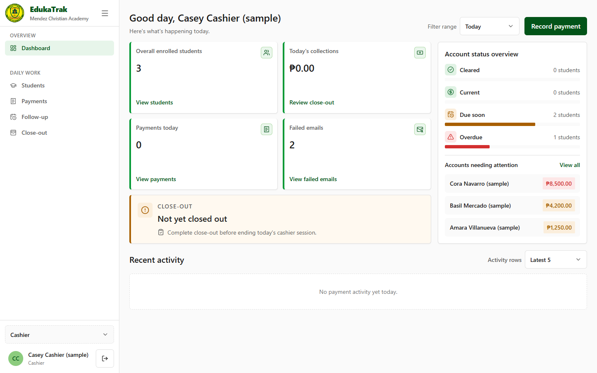
- Fix: use `en.app.name` in `Sidebar.tsx:175` if the "k" is not deliberate. Not changed here because `layout.test.tsx` asserts "EdukaTrak" (Decision 1). The separate "EducatraK" casing in the live Users role-change warning **was fixed** (Section 8).

**G-02 · Check 8 · Inconsistent · all roles · 1440**
- Steps: run axe with the `wcag21a` tag on any shell page.
- Actual: `label-content-name-mismatch` (WCAG 2.5.3 Label in Name). The role preview trigger shows "Cashier" but is named "Preview role". The user card shows the user's name but is named "Account menu", and it navigates to `/profile` rather than opening a menu. The dashboard triggers show "Today" / "Latest 5" but are named "Filter range" / "Activity rows".
- Expected: the accessible name contains the visible text (WCAG AA, `03-Design` §4).
- Fix: build the names to include the visible text (e.g. `aria-label={\`Preview role: ${label}\`}`), and rename "Account menu" to "Open my profile".

**G-03 · Check 10 · Visual polish · Cashier/Accounting · all widths**
- Actual: stat cards on the student profile, payment detail, account detail, close-out and My profile use a dashed-circle icon (`CircleDashed`). It reads as a loading spinner or an unfinished placeholder.
- Evidence: 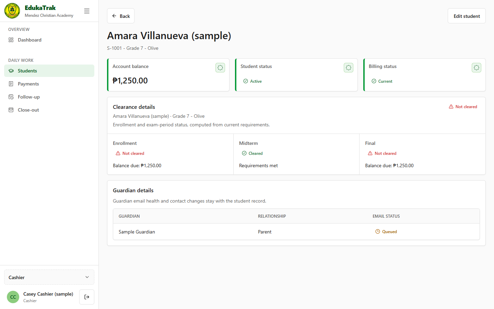
- Fix: use the meaningful icons the dashboard KPIs already use (wallet, user, receipt, shield), or drop the icon slot.

**G-04 · Check 3 · Inconsistent · Cashier/Accounting · all**
- Actual: three date formats. ISO `2026-06-15` appears in the payments list, payment detail, receipt and statement payment rows. `Jun 01, 2026` appears in schedules and statement installments. `Oct 25, 2026, 8:22 AM` appears on dashboards and logs. The Statement table mixes ISO and long formats in one column.
- Evidence: 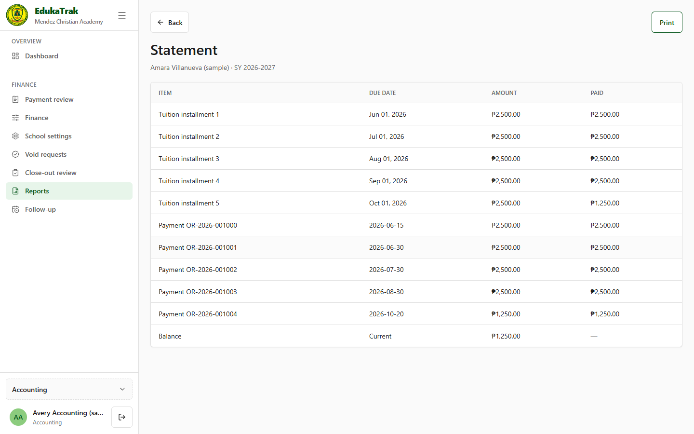
- Expected: one date format (`03-Design` §5.15 consistency).
- Fix: route every date through `lib/dates.ts` `formatShortDate` ("Jun 15, 2026"), and use date-time only where time matters.

**G-05 · Check 3 · Inconsistent · Cashier/Accounting · all**
- Actual: account detail shows raw lowercase enum labels (`paid`, `due soon`); every other screen uses Title Case (`Due soon`, `Overdue`).
- Evidence: 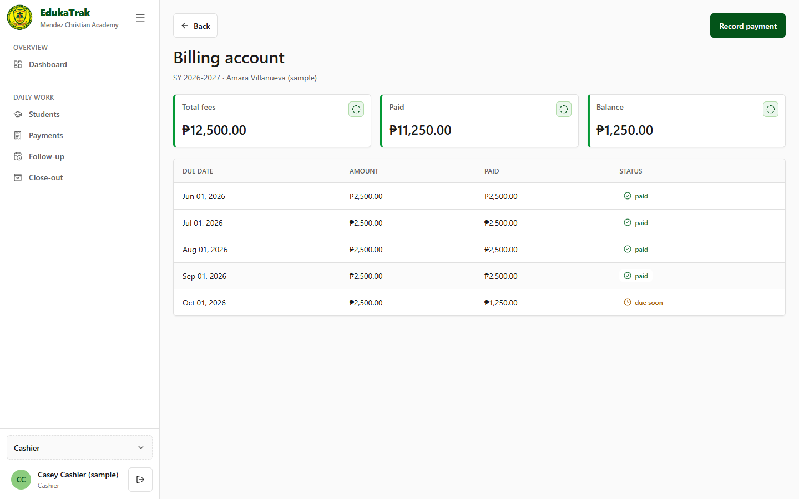
- Fix: map installment status through `lib/status.ts`, as the list views do.

**G-06 · Check 4 · Inconsistent · Cashier/Accounting · 1440**
- Steps: open the payment confirm dialog (or follow-up review, or void approve), then press Esc.
- Actual: the dialog closes, but focus lands on `<body>`, not the button that opened it.
- Expected: focus returns to the opener (`03-Design` §4, keyboard-first).
- Fix: in `MockDialog` / shared `Dialog`, keep Radix's default `onCloseAutoFocus` or restore focus to the trigger ref.

**G-07 · Check 4 · Inconsistent · Accounting/Admin · 1440**
- Actual: Add fee item, Edit user, and the live Users role field use native `<select>` (browser chrome). Dashboard range, Add student grade and Create user role use the styled `DropdownSelect`.
- Evidence: 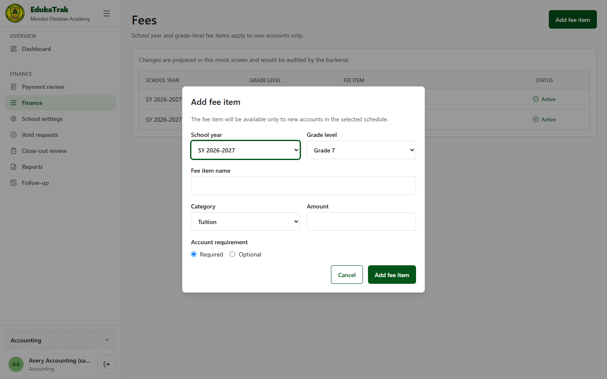
- Fix: use `DropdownSelect` in dialogs as well (Decision 11).

**G-08 · Check 3 · Inconsistent · Cashier · 1440**
- Actual: the primary action sits bottom-left on Add/Edit student ("Create student"), My profile ("Update password") and Request void. It sits bottom-right on Record payment, Close-out and dialogs.
- Expected: "The primary action sits bottom-right of its form, consistently" (`03-Design` §4).
- Evidence: 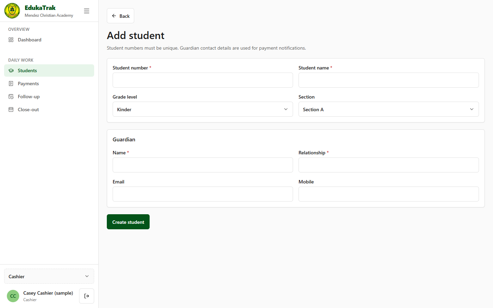
- Fix: `flex justify-end` on those form footers, and add a Cancel/neutral button beside them (Decision 7).

**G-09 · Check 1 · Redundant · Cashier/Accounting · 1440**
- Actual: card titles repeat the page title or the selected tab. "Record payment" is the h1 and the card title. "Today's close-out" is a tab and the card heading. "Notification log" is a tab and the card heading. "Follow-up" is the page title and the first toggle.
- Evidence: 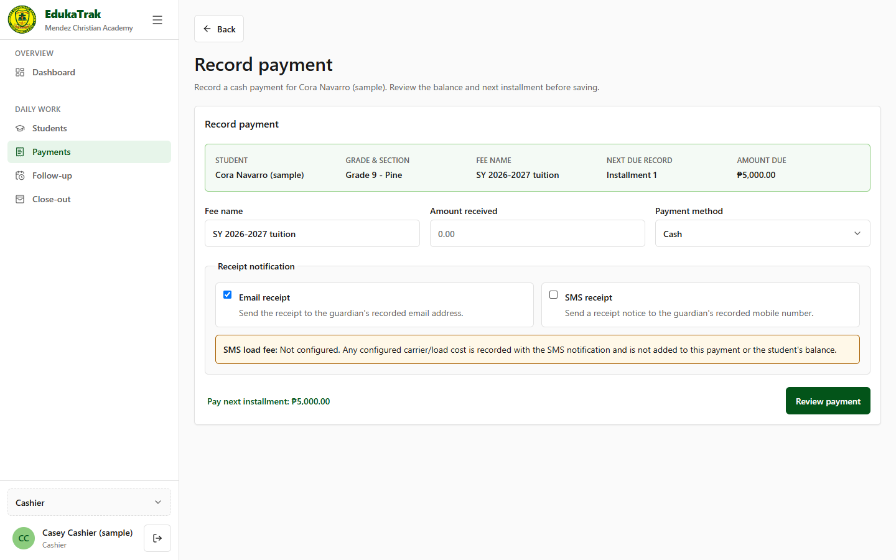
- Fix: keep the page h1 and the tab. Drop the card heading, or turn it into a meaningful subheading ("Student and amount").

**G-10 · Check 2 · Cosmetic (outside spec) · all · 375 (mobile emulation)**
- Actual: `index.html` sets `<meta name="viewport" content="width=1366, initial-scale=1">`. A real phone shows a 375px window cropped out of a 1366px page, the Sign in button is cut off, and the user can't zoom out. As a narrow desktop window (no emulation), the responsive CSS works: horizontal nav, no page overflow.
- Evidence: 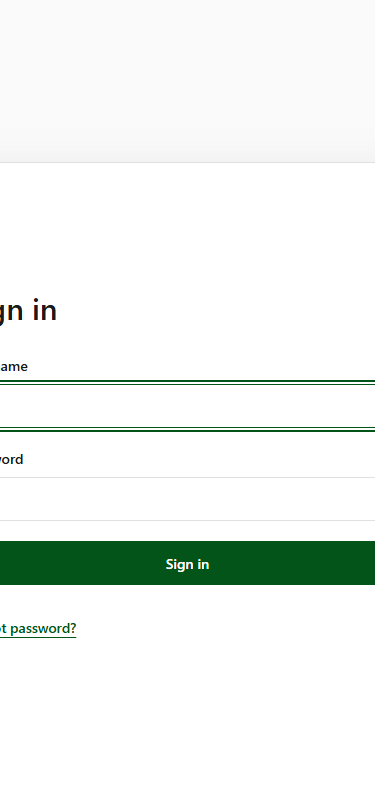 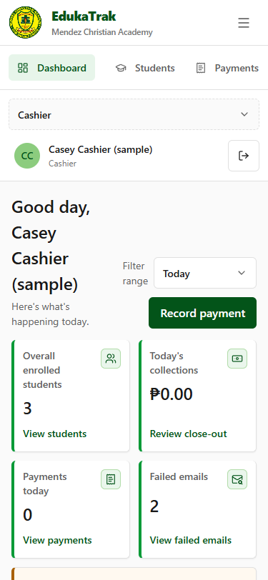
- Fix: no action required by spec (desktop only). If tablets ever matter, use `width=device-width` and rely on the existing responsive CSS.

**G-11 · Check 9 · Inconsistent · Auditor · 1440**
- Steps: as Auditor, open `/nope`.
- Actual: "Access denied". Every other role gets "Not found".
- Fix: in `App.tsx`, apply the Auditor allow-list only to known routes, and let unknown paths fall through to `/404`.

### 3.1 Login (`/login`)
No new defects. Empty-submit inline errors, a generic failure message, a 30-second lock after three attempts with inputs disabled, forgot-password help, the password visibility toggle, and autofocus all work. Visual: **4/5**.

### 3.2 Cashier dashboard (`/`)

**CD-01 · Check 3 · Inconsistent · Cashier/Accounting · 1440**
- Actual: the screens disagree with each other.
  - Dashboard says "Current 0 students", but the Students list shows Amara as **Current**.
  - "Today's collections ₱0.00 / Payments today 0", but Close-out shows **System cash total ₱1,250.00**.
  - The dashboard still says "Not yet closed out" after close-out was locked.
  - Accounting dashboard shows "Unsigned close-outs 2", but Close-out review lists 1.
  - Outstanding report omits Amara, whom the dashboard lists as "needing attention".
  - The student profile shows Billing "Current" while clearance says "Balance due ₱1,250".
  - Follow-up shows "12 days overdue" for an installment due Sep 01.
- Evidence:  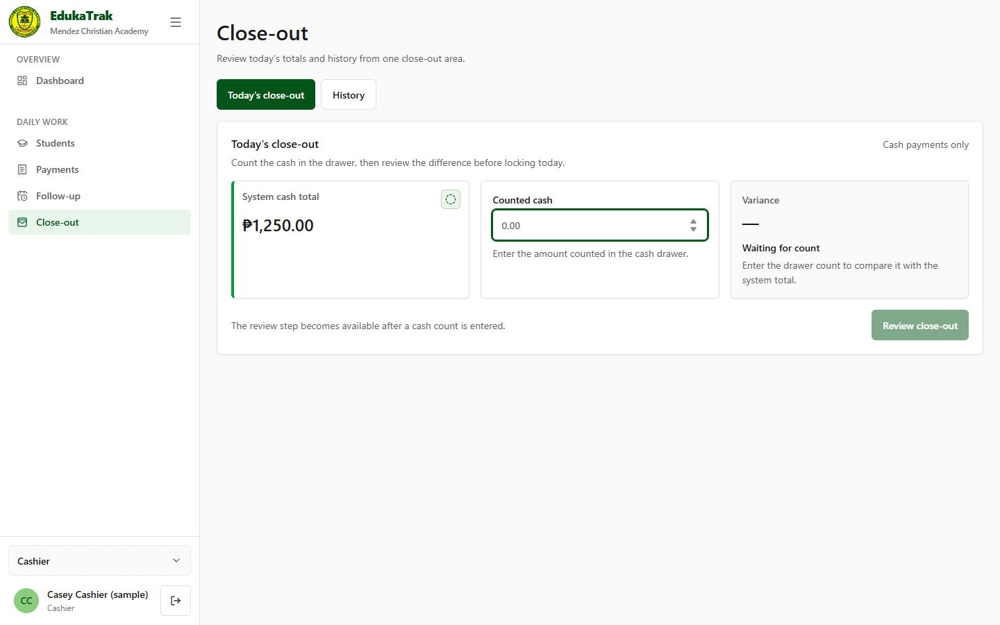
- Expected: one source of truth per figure (the dashboard mock is documented as derived from `mockBilling`).
- Fix: derive student billing status, close-out totals and follow-up days from `mockBilling.ts` and today's Manila date. Have the close-out lock update the shared mock state.

**CD-02 · Check 3 · Cosmetic** — "1 students" pluralization. Fix: use `Intl.PluralRules` or a simple ternary.

**CD-03 · Check 8 · Inconsistent · Cashier · 1440** — axe `color-contrast` (serious) on the attention-list amount badges: 4.21:1 and 4.26:1. Repeats IUX-10 from 2026-10-09. See Decision 6.

**CD-04 · Check 8 · Inconsistent** — attention-list amounts carry their status by color alone (red/amber badge, no icon or text). Expected: "Status is never shown by color alone" (`03-Design` §4). Fix: add the status icon and label ("Overdue") beside the amount.

**CD-05 · Check 4 · Inconsistent** — KPI links ("View students", "Review close-out", …) are 32px tall and "View all" is 21px, against "buttons at least 44px tall" (`03-Design` §4). Fix: make the whole KPI card the link target, or pad the links to 44px.

### 3.3 Students list (`/students`)

**S-01 · Check 3 · Inconsistent · Cashier/Accounting · 1440**
- Steps: type "zzzz" in the Students search.
- Actual: the list does not filter and no empty state appears. The field is a typeahead that opens a student profile on Enter. Payments, Accounts and Users searches filter the table instead.
- Fix: make Students search filter the table like the other lists, and keep the suggestion list as an optional enhancement. Visual **4/5**.

### 3.4 Student profile (`/students/:id`)

**SP-01 · Check 6 · Inconsistent (dev mock) · Cashier** — the profile has no Record payment or account link (Back and Edit student only). F1 says payment "opens from a student profile". The tracker notes the live profile has a Cashier payment deep link, and the M2.1 tab reconciliation is already tracked in Issues-and-TODOs (the "Confirm full persistence…" VERIFY item). Not duplicated here beyond the dev-mock gap. Fix: add the same `Record payment` link (`/payments/new?student=:id`) to the mock profile.

**SP-02 · Check 8 · Inconsistent** — axe `heading-order`: `#clearance-details-heading` (h3) follows the h1 with no h2. Fix: make the card headings h2.

**SP-04 · Check 5 · Broken (dev mock) · Cashier · 1440**
- Steps: open Cora's profile (`/students/sample-1003`) and click Edit student.
- Actual: the form shows **S-1001 Amara Villanueva**, and the guardian fields are empty. Create student always redirects to Amara's profile and never adds the record. If you go straight from Add to Edit, the Add form's values and its duplicate error carry over.
- Evidence: 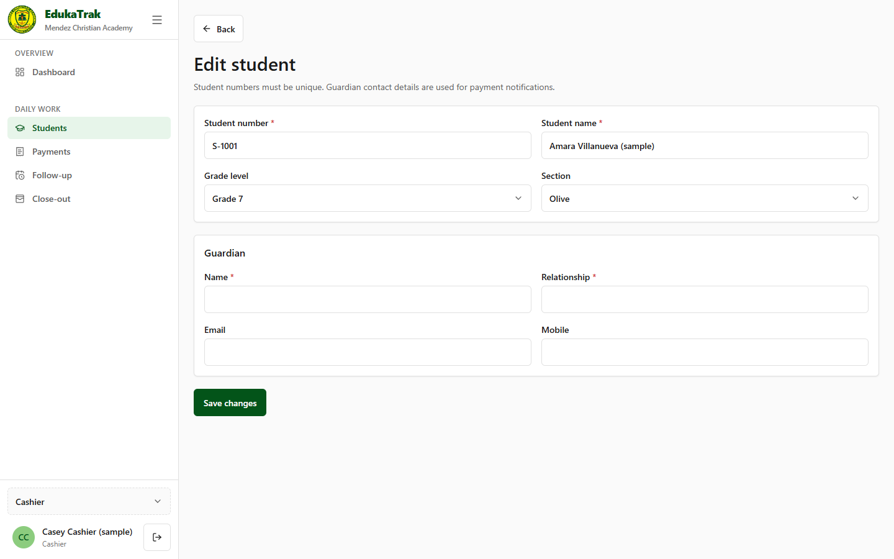
- Expected: edit the selected student (M2.1, B09).
- Fix: load the student by `:id`, add a `key={id}` on the form, and navigate to the new or edited record (Decision 3).
- Visual (profile) **3/5**.

### 3.5 Add / Edit student (`/students/new`, `/students/:id/edit`)

**AS-01 · Check 5 · Inconsistent · Cashier · 1440** — empty submit shows native browser bubbles ("Please fill out this field."). Login and Record payment use styled inline errors. Expected: inline error text next to the field (`03-Design` §5.9). Evidence: 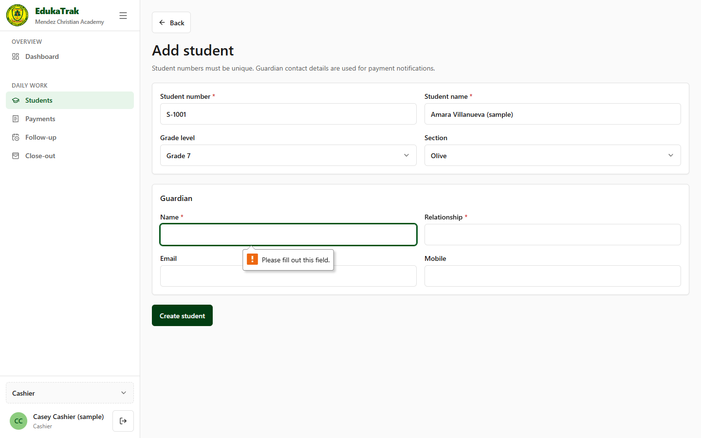 Fix: `noValidate` plus inline messages, reusing the login error pattern.

Placement and default concerns are covered by G-08 and J3. Visual **3/5**.

### 3.6 Accounts (`/accounts`) and Account detail (`/accounts/:id`)

**AC-01 · Check 6 · Broken · Cashier/Accounting · 1440**
- Actual: `/accounts` is not in the Cashier or Accounting sidebar, and no in-app link points to it. Account rows are not clickable, so account detail can't be reached at all. The link scan found zero anchors or buttons leading to either route.
- Evidence: 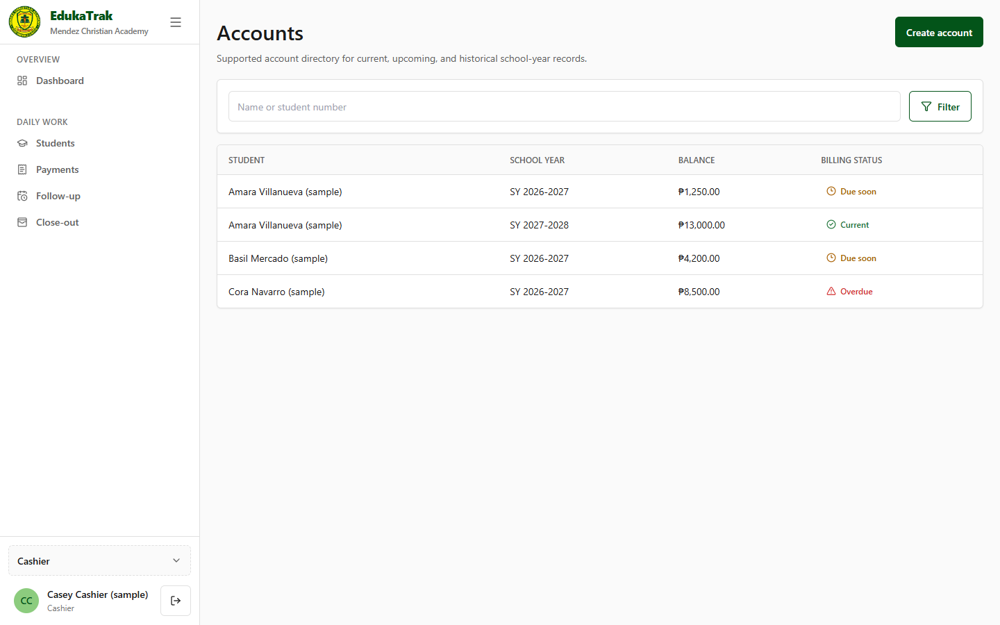
- Expected: "every screen is reachable" (audit scope). The route table lists `/accounts` (M3).
- Fix: link student-profile rows to their accounts and make account rows clickable (Decision 4).

**AC-02 · Check 6 · Inconsistent (dev mock)** — account detail has no installment labels, payments, adjustments or activity. Decision `2026-10-25-billing-account-activity-scope.md` defines an activity feed (live only). Fix: mirror the live detail sections in the mock.

Visual: list **3/5**, detail **2/5**.

### 3.7 New account wizard (`/accounts/new`)

**W-01 · Check 5 · Broken · Cashier · 1440 — FIXED**
- Steps: type "Basil" and press Enter (or click the suggestion).
- Actual (before fix): the app left the wizard and opened Basil's profile, because the `StudentSearchField` had no `onSelect`.
- Fix applied: the wizard keeps the selection. Re-tested: the URL stays `/accounts/new` and the value is "Basil Mercado (sample)".

**W-02 · Check 5 · Broken (dev mock)** — Continue works with no student, and Create account then navigates to `/accounts/account-1001?created=1`, which is **Not found**. Expected: F2 requires a student, and creation lands on the new account. Fix: block Continue until a student is selected, and navigate to a real id (Decision 3).

**W-03 · Check 1 · Redundant** — two Back buttons (page header and wizard footer). On step 1 the disabled wizard Back still looks enabled (light green outline). Evidence: 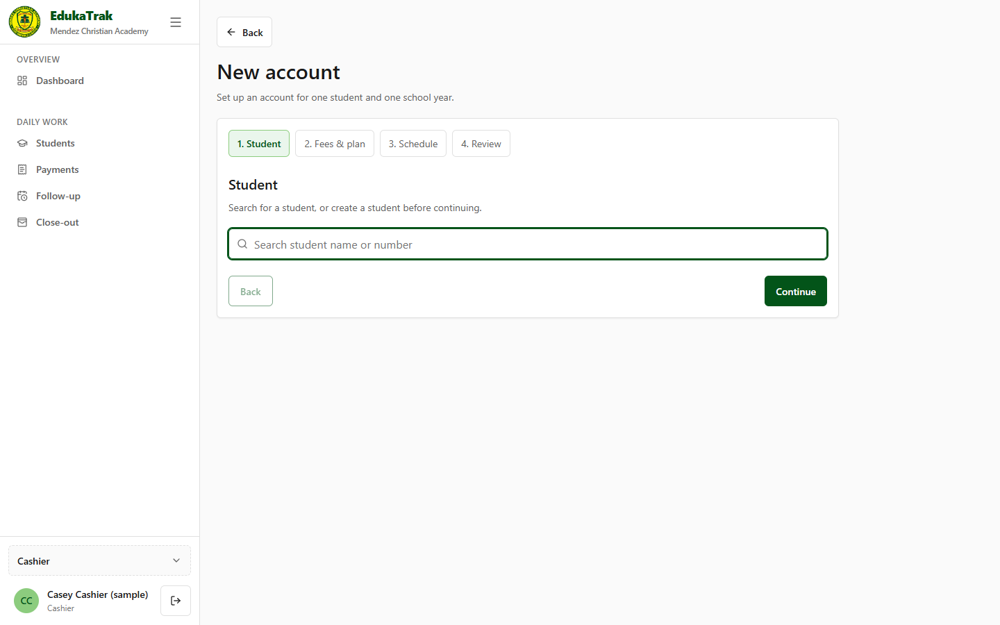 Fix: hide the wizard Back on step 1, and keep the header Back only as "Cancel".

Visual **2/5**.

### 3.8 Record payment (`/payments/new`)

**P-01 · Check 5 · Broken · Cashier · 1440 — FIXED**
- Steps: open `/payments/new` without `?student=`.
- Actual (before fix): the search box was empty, but Amara was silently selected. "Pay next installment" plus Confirm saved a real payment (OR-2026-001011) for her without the cashier choosing anyone. After saving, the "fresh" form preselected her again.
- Expected: F1 step 2–3, the student appears only after search or selection.
- Evidence (before fix): 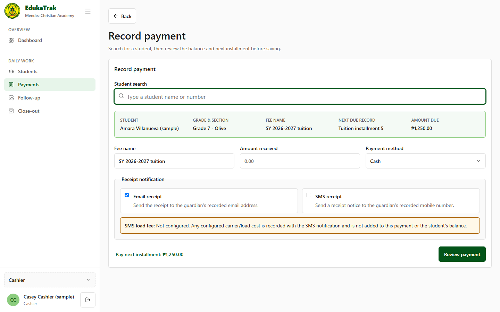
- Fix applied: no student is selected on an empty query, so Review payment stays disabled until one is chosen. Re-tested: the summary is gone, Review is disabled, selecting Cora works, and `?student=` preselection still works.

**P-02 · Check 2 · Cosmetic · Cashier · 1280×720** — Review payment sits at y=818, below a 720px fold, on the most-used flow. Evidence: 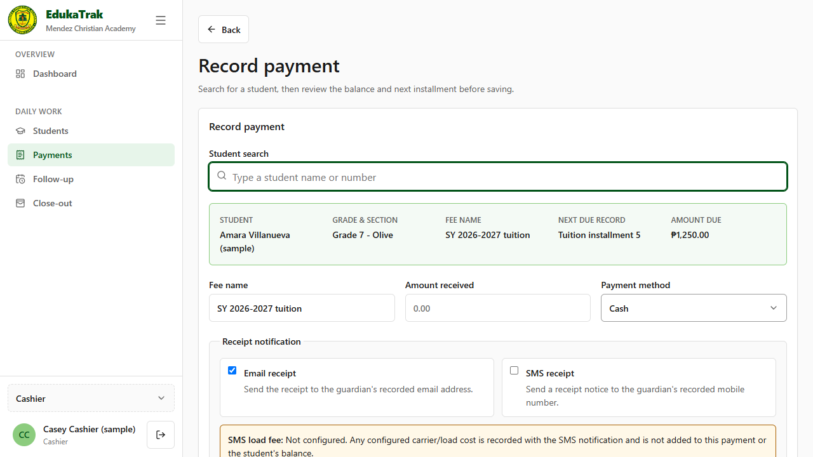 Fix: collapse the SMS load-fee notice into helper text, or make the action row sticky.

**P-03 · Check 1 · Redundant** — Payment method is a dropdown with exactly one option ("Cash"). Policy is cash-only (`Scope` §2.2). Fix: show "Method: Cash" as static text.

**P-04 · Check 5 · Cosmetic** — the amount field accepts letters ("12abc") and then reports "more than zero". Fix: filter to digits and a decimal point, and say "Enter a number such as 1250.00".

Positives verified: confirm dialog repeats student, amount, method and new balance; focus is trapped; double-click on "Confirm and save" created **one** record; inline success shows Preview receipt / Done; the overpay message is actionable. Visual **3/5**.

### 3.9 Payments list (`/payments`)
**PL-01 · Check 3 · Inconsistent** — the search box has no search icon and a lighter style than the Students and Clearance searches. Evidence: 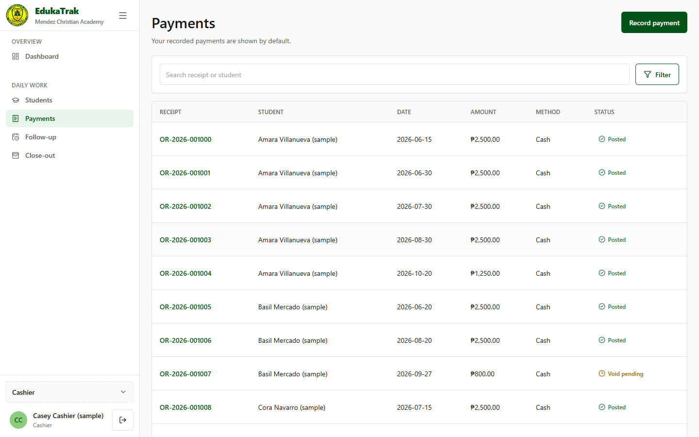 Fix: use one search-input component. Dates are covered by G-04. Back/forward between list and detail works. Visual **4/5**.

### 3.10 Payment detail (`/payments/:id`)

**PD-01 · Check 2 · Inconsistent · Cashier/Accounting · 1024 and 1280**
- Actual: the Student and Recorder names are truncated with an ellipsis and no tooltip at every width. At 1024 and 1280, the Allocation **Amount** column and the Audit **Status** column are hidden behind an internal horizontal scroll with no visible scrollbar.
- Expected: no breakage at 1024 (Project Spec target-screen rule).
- Evidence: 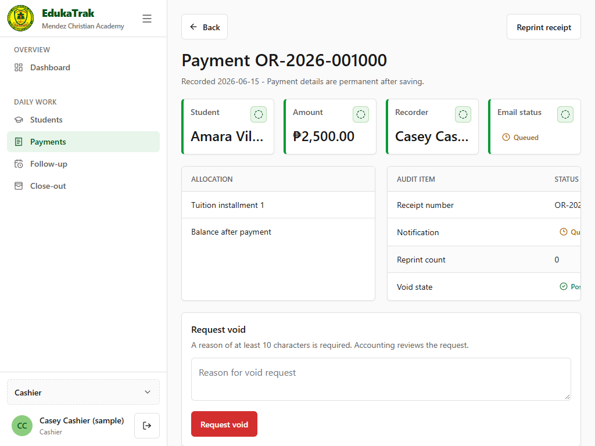
- Fix: stack the two tables vertically below `xl`, let the stat-card values wrap, or add `title`.

**PD-02 · Check 1 · Redundant** — the "Email status" card and the "Notification" row show the same value. The receipt number appears in the h1 and again in the audit table. Evidence: 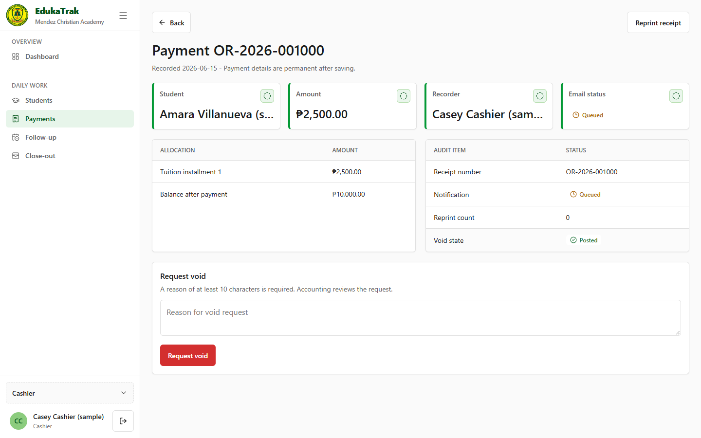 Fix: drop the card or the row, and drop the receipt row.

**PD-03 · Check 1 · Broken (dev mock) · Cashier · 1440**
- Actual: "Request void" has **no click handler**. Empty, short and valid reasons all do nothing. The textarea is placeholder-only, with no label. The button uses destructive red, while the 15:32 changelog moved the live button to secondary because the request is reviewable, not destructive.
- Expected: F3 says reason (min 10 chars) then "Void pending". `03-Design` §5.6 reserves destructive styling for irreversible actions.
- Evidence: 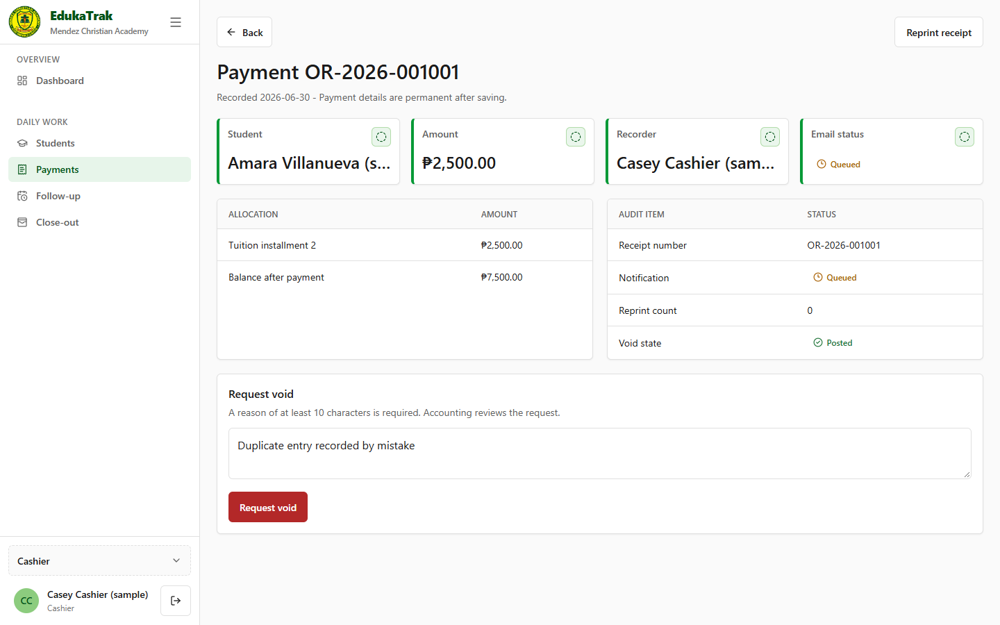
- Fix: see Decision 2. Either way, add a visible label and secondary styling.

**PD-04 · Check 3 · Cosmetic** — "Void state: Posted" mixes two concepts. Fix: "Payment status: Posted".

Visual **3/5**.

### 3.11 Receipt print view (`/receipts/:id/print`)
**R-01 · Check 3 · Inconsistent** — user-facing developer text: "This is a half-page receipt block. Receipt title and paper size are controlled in settings." Also "REPRINT count: 0" (shouty) and "Void mark: none". Evidence: 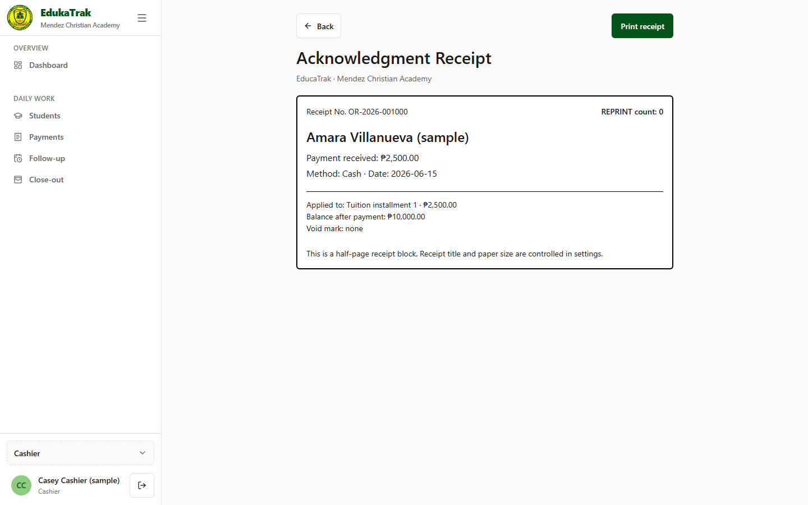 Expected: no debug text shown to users (audit scope Check 3). Fix: remove the note, show the reprint mark only when count > 0, and show VOID only when voided. Visual **2/5**.

### 3.12 Follow-up (`/followup`) and Notification log (`?view=notifications`)
- **F-01 · Check 3 · Cosmetic** — "missing email" is plain lowercase text with no warning icon. Fix: a warning badge "No email on file".
- **F-02 · Check 3 · Cosmetic** — the description "…without merging their records" is implementation-speak. Fix: "Send reminders for overdue accounts and review delivery history."
- **F-03 · Check 2 · Cosmetic · 1024** — the notification log table (846px wide) scrolls inside a 686px card. Evidence: 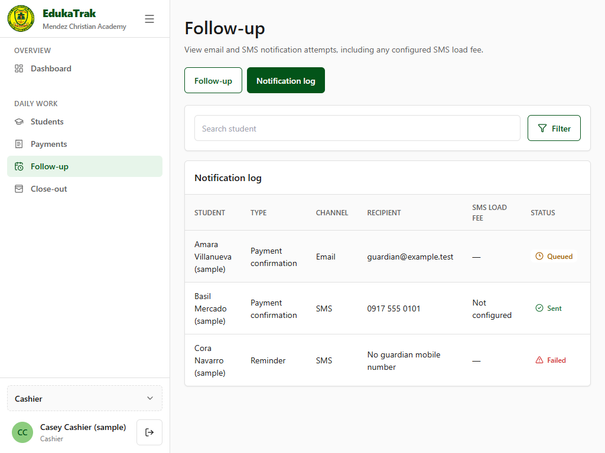
- Positives: the review dialog lists recipients, flags the missing email and previews the message; Print list calls print; the view is kept in the URL.
- Visual **3/5**.

### 3.13 Close-out (`/closeout`) and history

**CO-01 · Check 5 · Inconsistent · Cashier · 1440**
- Actual: after "Confirm and lock", "Close-out locked for today." appears, but the count and explanation fields still look editable. The hint "Add a variance explanation before reviewing." stays visible although an explanation was entered. No summary opens.
- Evidence: 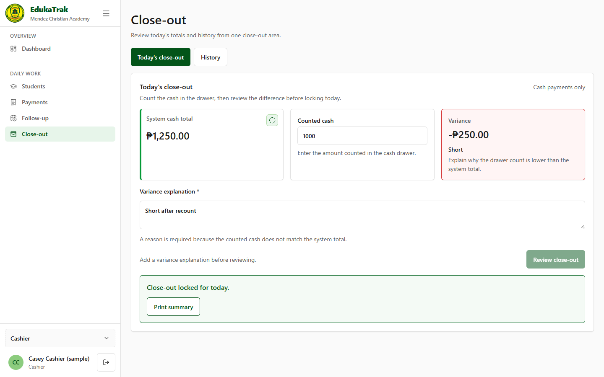
- Expected: F6 says "day locks and a printable summary opens."
- Fix: render a read-only locked summary with Print, and hide stale hints (Decision 10).

**CO-02 · Check 1 · Broken (dev mock) · Cashier/Accounting · 1440**
- Actual: the "View" (Cashier) and "Sign off" (Accounting) cells are plain `<td>` text with `cursor:auto`. Clicking does nothing, so Accounting **cannot sign off** in the mock.
- Evidence: 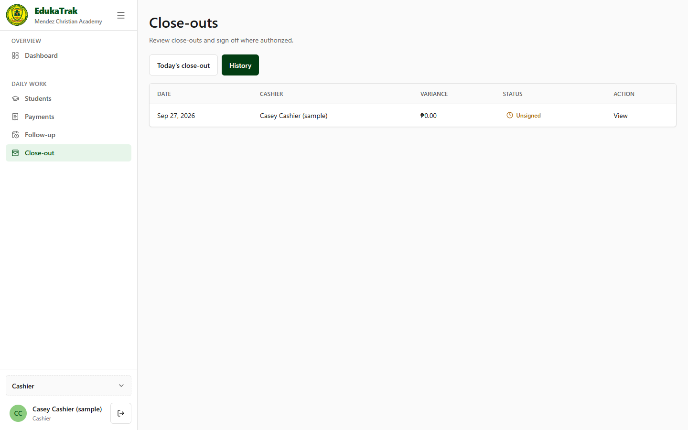 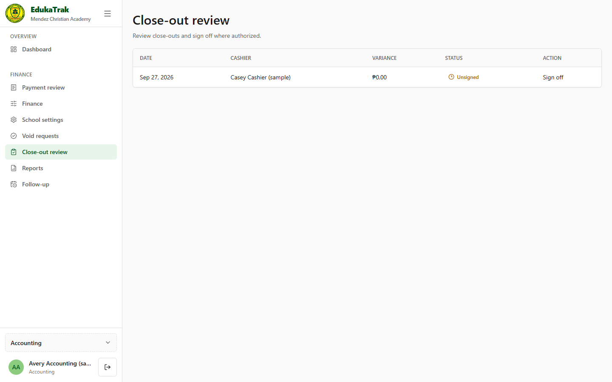
- Fix: make them buttons that open a detail or sign-off confirm dialog (Decision 2).

**CO-03 · Check 1 · Redundant** — two history entry points. The History tab switches the URL to `/closeout/history` and the h1 changes "Close-out" → "Close-outs". The dev mock ignores `/closeout?view=history`, which still shows Today. Fix: one route with the view in a query parameter and a stable title.

**CO-04 · Check 4 · Cosmetic** — the counted-cash input shows the native number spinner on hover/focus. Fix: `type="text" inputMode="decimal"`, as the Amount received field already does.

Visual **3/5**.

### 3.14 Accounting dashboard (`/`)
- **AD-01 · Check 1 · Redundant** — "Pending void approvals 1" and "Unsigned close-outs 2" KPIs repeat as "Accounting workspace" rows with the same counts, and those rows duplicate three sidebar items. Evidence: 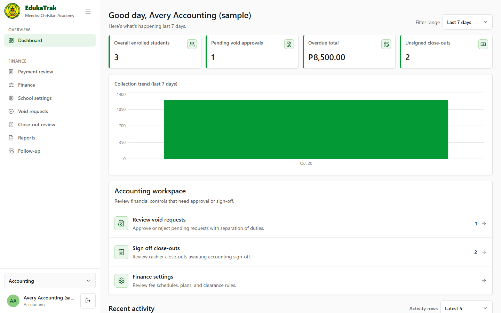 Fix: make the KPI cards the links and remove the workspace panel.
- **AD-02 · Check 10 · Visual polish** — Collection trend with one data point renders a single bar about 800px wide. The y-axis has no ₱ and its ticks are odd ("1050", "1400"). Fix: cap `maxBarSize`, add a ₱ formatter, and use nice ticks.
- **AD-03 · Check 3 · Inconsistent** — Accounting KPI cards are not links; Cashier KPI cards are.
- Visual **3/5**.

### 3.15 Void requests (`/voids`)
Approve and Reject open confirm dialogs that repeat the receipt and amount; Reject updates the row to "Void rejected". Focus return is covered by G-06. See J6. Visual **4/5**.

### 3.16 Reports (`/reports`, daily, monthly, outstanding, statement)
- **RP-01 · Check 3 · Inconsistent** — card titles and page titles differ: "Daily collection" → "Daily report", "Outstanding balances" → "Outstanding", "Student statement" → "Statement". Evidence: 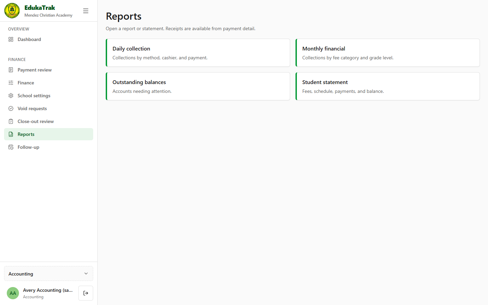 Fix: use the card title as the h1.
- **RP-02 · Check 6 · Inconsistent (dev mock)** — Daily report shows no date and has no date selector (the Filter has only "Section"). Evidence: 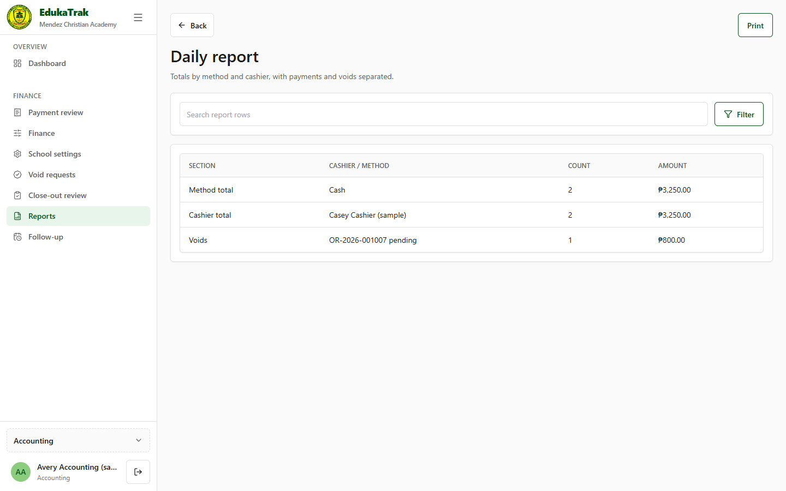 Fix: show the report date in the header and add a date filter (the live report has one).
- **RP-03 · Check 6 · Inconsistent (dev mock)** — the Student statement card opens Amara directly, with no student picker.
- Positives: the Print action calls `window.print`.
- Visual: hub **4/5**, reports **3/5**.

### 3.17 Finance & system settings (`/settings/*`)
- **FS-01 · Check 6 · Broken · Accounting/Administrator** — `/settings/plans` and `/settings/clearance-rules` (Accounting), `/settings/receipt` and `/settings/email` (both roles), and `/admin/roles` (Administrator/Super Admin) have **no link, tab or button anywhere**. They open only by typing the URL. Evidence:  Fix: add sub-tabs on Fees (Fees · Plans · Clearance rules) and on School settings (School · Receipt · Email), plus a "Role matrix" link on Users (Decision 4).
- **FS-02 · Check 3 · Inconsistent** — nav labels and h1s don't match: nav "Finance" → "Fees", `/settings/email` → "Notifications", `/settings/clearance-rules` → "Clearance" (same word as the Registrar's Clearance page).
- **FS-03 · Check 3 · Cosmetic** — School settings says "Manage…" to Accounting, which has read-only access.
- Visual **3/5**.

### 3.18 Administrator dashboard (`/`)
- **AM-01 · Check 3 · Inconsistent** — "Last backup Oct 25, 2026, 8:37 AM — Succeeded" and "Active users 14" contradict the Backups page ("not connected in this preview") and the 3-user list. Evidence: 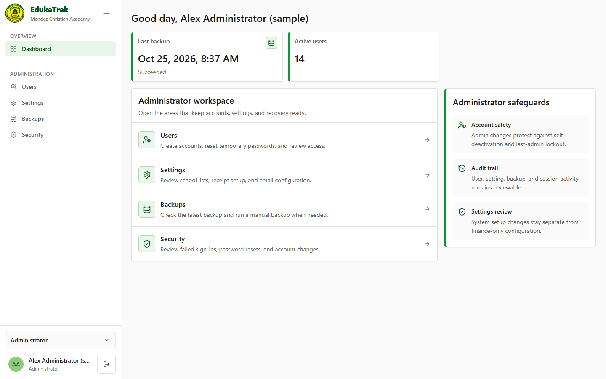 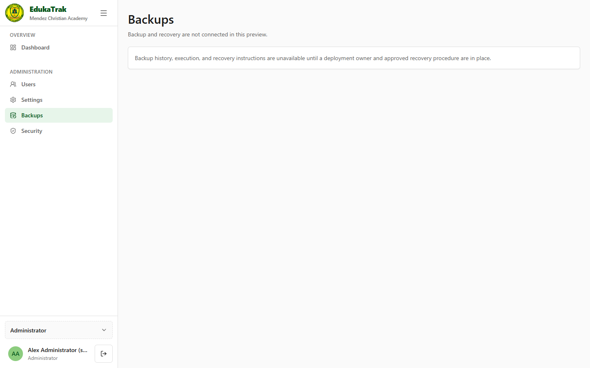 The tracker removed fabricated backup data from the Backups page on 2026-10-25, but the dashboard still shows it. Fix: show "Backup status unavailable", and derive the user count from the users fixture (Decision 8).
- **AM-02 · Check 1 · Redundant** — the "Administrator workspace" rows duplicate the sidebar one-to-one, and "Administrator safeguards" is static, decorative text. Expected: "Decorative dashboards … out of scope" (`Scope` §2.2). Fix: remove both and keep actionable status tiles.
- **AM-03 · Check 2 · Cosmetic · 1024** — the backup timestamp is clipped. Evidence: 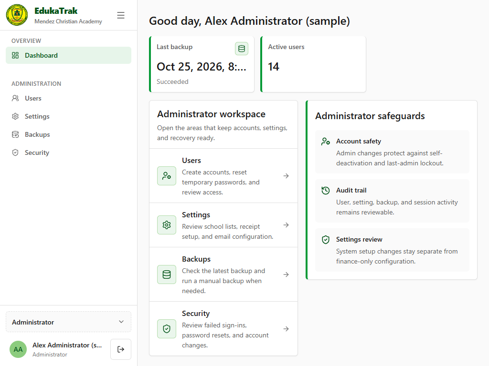
- Visual **3/5**.

### 3.19 Users (`/admin/users`)
- **U-01 · Check 2 · Broken · Administrator · 1440** — a 120-character name with no spaces (created with the in-app form) widens the Name column. The Role, State and **Action (Edit)** columns are pushed past the card edge for **every** row. Evidence:  Fix: `break-words` / `max-w` with truncation and a `title` on the name cell, plus `table-fixed` widths.
- **U-02 · Check 5 · Inconsistent** — after Create user, no success message and no one-time temporary password appear, although the page says "Temporary passwords are shown once after creation" (F8). Fix: show the success panel with the temporary password and a copy button.
- **U-03 · Check 9 · Inconsistent — FIXED** — the mock Edit dialog let an Administrator promote any user to **Accounting Officer** or **Administrator**. Open Decisions 31.5/31.6 and the tracker's 15:01:57 fix allow neither. Fixed to mirror the create rules plus the current role. Re-tested: Administrator editing a Cashier sees Cashier / Auditor / Registrar; Super Admin additionally sees Administrator.
- **U-04 · Check 6 · Inconsistent (dev mock)** — 33 users render with no pagination. The live tables use 10/25/50 paging (tracker 12:55:14).
- Visual **3/5**.

### 3.20 Security / Audit (`/admin/audit-log`, `/admin/security-events`)
- **SE-01 · Check 3 · Inconsistent** — the same path `/admin/audit-log` is "Security" (Administrator) or "Audit" (Super Admin, Auditor). Super Admin's "Security" lives at `/admin/security-events` (Decision 9).
- **SE-02 · Check 5 · Broken (dev mock) · Super Admin** — in dev, Super Admin "Security" renders the live component, which calls the backend and shows "The request could not be completed". The error state with Try again is itself good. Evidence: 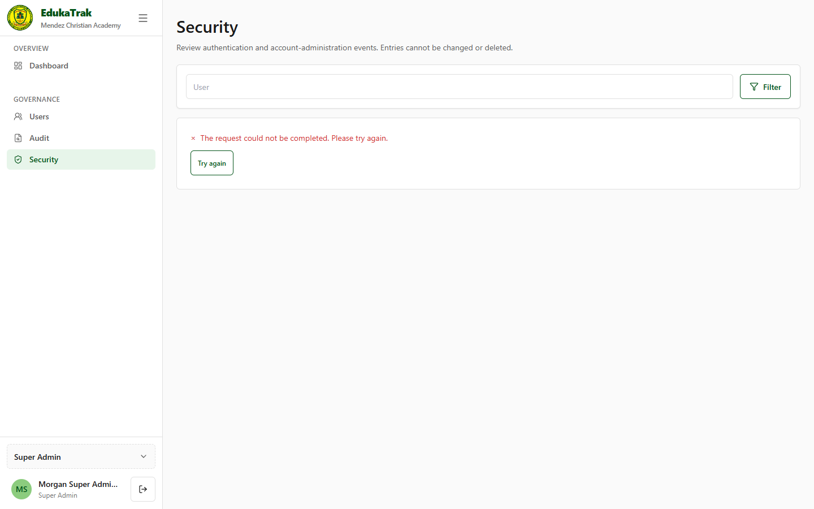 Fix: route Super Admin to the mock security log in dev, as Administrator already is.
- **SE-03 · Check 3 · Inconsistent** — security events are unsorted (9:00, 8:30, 9:15, 9:20 …) while the audit list is newest-first. Evidence: 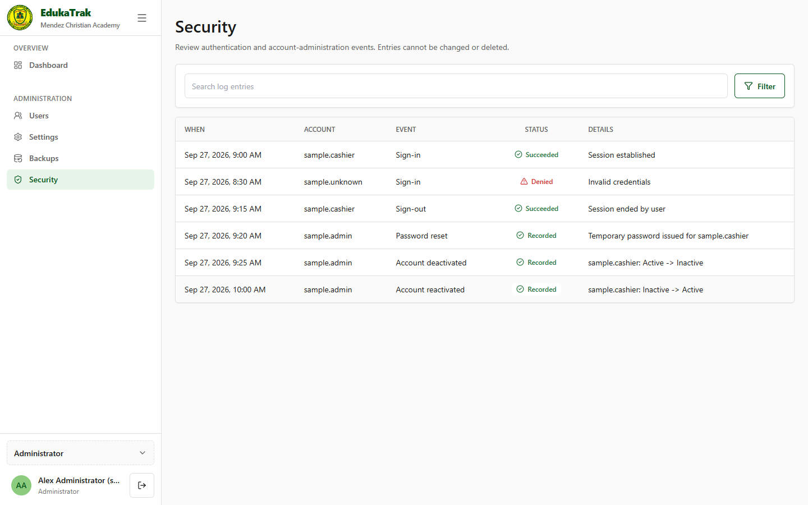 Fix: sort newest-first.
- **R-08 · Check 1 · Redundant (dead UI)** — "View before/after values" in the audit table is plain text with no action.
- Visual **3/5**.

### 3.21 Roles (`/admin/roles`)
- **RO-01 · Check 8 · Inconsistent — FIXED** — axe `scrollable-region-focusable` (serious): the horizontally scrolling matrix couldn't be reached by keyboard. Added `tabIndex={0}`, and axe no longer reports it. Evidence (before fix): 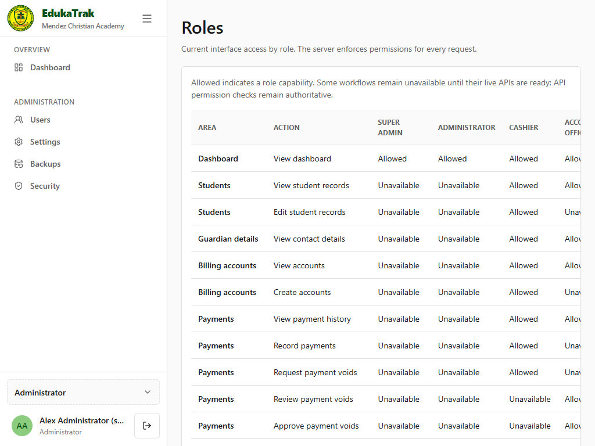
- Reachability is covered by FS-01. Visual **3/5**.

### 3.22 Backups (`/admin/backup`)
The unavailable state is clear and honest. Visual **3/5**. (Contradicted by AM-01.)

### 3.23 Super Admin dashboard
Governance links and KPIs only; no defects beyond SE-02 and AM-01 (it shows the same fabricated backup timestamp). Visual **3/5**.

### 3.24 Auditor dashboard
- **AU-01 · Check 10 · Visual polish** — three KPI cards plus a 40px "Open audit" button floating right over an empty canvas. Evidence: 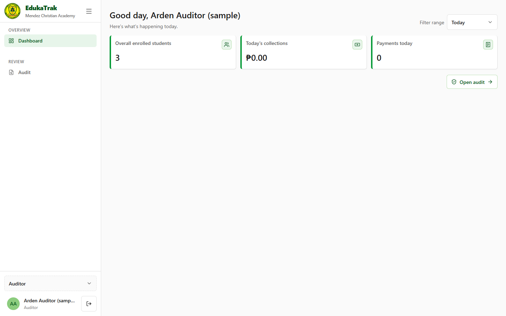 Fix: see the Section 5 proposal. Visual **2/5**.

### 3.25 Registrar dashboard and Clearance
- **RG-01 · Check 9 · Broken · Registrar · 1440 — FIXED** — searching a student on the dashboard and pressing Enter navigated to `/students/:id` → **Access denied**. Registrar has no `student.view`, so the dashboard's only action was a dead end. Evidence (before fix): 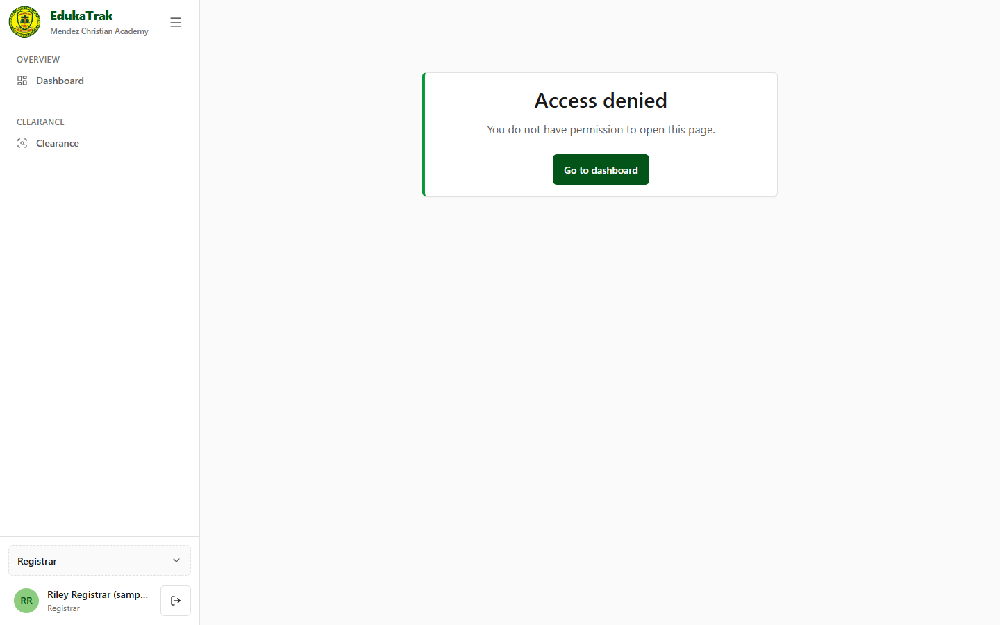 Fixed to mirror the live search (`/clearance?studentId=…`), and the mock Clearance page now reads `studentId`. Re-tested: it lands on Cora's clearance, with no denial.
- **RG-02 · Check 3 · Inconsistent** — Clearance preselects Amara before any search, under "Select a student to review…" (Decision 5).
- **RG-03 · Check 3 · Inconsistent** — the **enabled** "Print exam permit" is a plain green text link, while the **disabled** one is an outlined button, so the disabled control looks more actionable. Evidence: 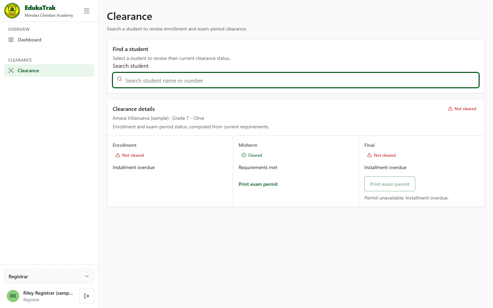 Fix: render both as the same secondary button with the disabled style and reason.
- **RG-04 · Check 1 · Redundant** — "Find a student" heading, "Select a student…" description and "Search student" label stack three labels on one input.
- Privacy (Check 9): on the dashboard, Clearance and Permit, no ₱, "balance" or guardian data was rendered for Registrar. Reasons are amount-free ("Installment overdue"). **Pass.**
- Visual: dashboard **3/5**, clearance **3/5**, permit **3/5**.

### 3.26 My profile (`/profile`)
- **PF-01 · Check 10 · Visual polish** — the left "Name" card stretches to the password card's height with a single line of content. Role and last login sit inside the "Change password" card. Evidence: 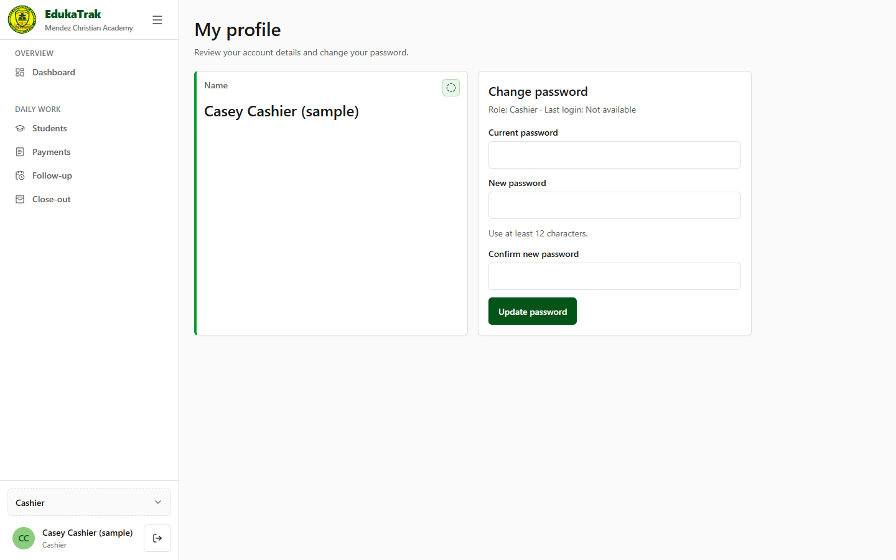 Visual **2/5**.

### 3.27 Check 7 — Awkward placement (judgment calls)
- **J1** (Cashier dashboard) — the "Today's collections" card's link reads "Review close-out", an unrelated destination. The "Accounts needing attention" rows look like links but aren't clickable. Proposal: link each attention row to the student or Record payment, and label the collections link "View payments".
- **J2** (Record payment with `?student=`) — the search field disappears, so the cashier can't switch student without going Back. Proposal: keep the search, prefilled.
- **J3** (Add student) — Grade defaults silently to "Kinder / Section A", which makes a wrong-grade record easy. Proposal: start with "Select grade" and require it.
- **J4** (Follow-up) — the primary "Send reminder details" sits top-right, far from the row checkboxes, disabled with no reason given. "Print list" sits bottom-left. Evidence: 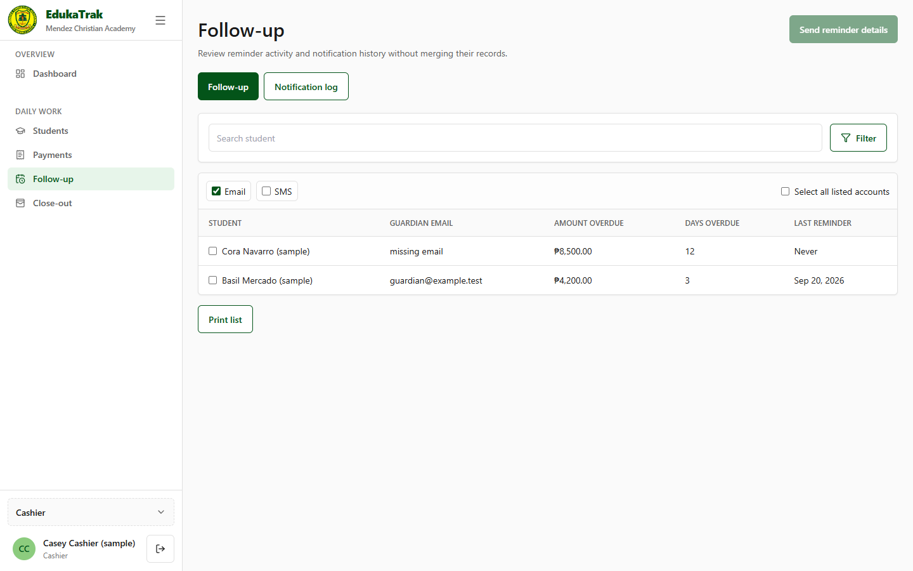 Proposal: a bulk-action bar above the table that appears on selection ("2 selected · Send reminders · Print list").
- **J5** (Edit user dialog) — red "Deactivate account" sits directly under "Reset password" and below the Save row in the same dialog. Super Admin's Create user defaults to the most privileged role (Administrator). Evidence: 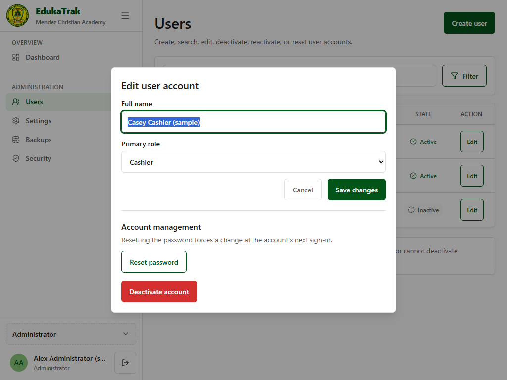 Proposal: put account-state actions in a separate "Danger zone" section or a confirm step, and default the role to Cashier.
- **J6** (Void requests) — no request date column and no link to the payment. Proposal: add a date column and make the receipt cell link to `/payments/:id`.
- **J7** (Edit user) — an Administrator can change their **own** role to Cashier (only self-deactivation is blocked). Proposal: disable the role field for one's own account (Decision 12).

---

## 4. Check-by-check coverage notes
- **Check 1 Redundancy:** G-09, P-03, PD-02, W-03, AD-01, AM-02, CO-03, RG-04, R-08, plus dead UI in PD-03/CO-02.
- **Check 2 Layout:** no page-level horizontal scroll at any width or role. Internal clipping: PD-01, F-03, RO-01 (1024/1280), U-01 (long names), AM-03. Stress: 0 rows (empty search), 3 rows, 33 users, a 120-character no-space name, non-English text (`Ñandú 漢字` renders correctly), and a ₱99,999,999,998,749.00 variance (fits). A 500-character note could not be typed into the close-out explanation (see Not covered).
- **Check 3 Inconsistency:** G-01, G-04, G-05, G-08, PL-01, R-01, RP-01, FS-02, SE-01, SE-03, RG-03, AD-03, CD-01. Standard to adopt: the design-system tokens in `03-Design` §5 and the most common existing pattern (Title Case statuses, `formatShortDate`, `DropdownSelect`, right-aligned primary).
- **Check 4 Interactivity:** every clickable element found has `cursor:pointer`. Dead text affordances: CO-02, R-08. Native controls: G-07, CO-04. Focus return: G-06. Focus trap works. Esc closes dialogs. Double-submit is safe for payments, close-out and user creation. Back/forward keeps the URL and view (payments, follow-up). **Reload signs the user out in dev mock** because the mock session is in memory; production restores the session through the API (see Not covered).
- **Check 5 States:** loading is not observable with mock data. Empty states exist (Recent activity, students search returns none). Error + retry seen on SE-02. Confirmations exist for payment, void decision, close-out and reminders. Gaps: AS-01, U-02, CO-01, PD-03.
- **Check 6 Missing/misplaced:** AC-01, FS-01, SP-01, AC-02, W-02, RP-02, RP-03, U-04.
- **Check 8 Accessibility:** axe at 1440 for every role and route found only `color-contrast` (CD-03), `heading-order` (SP-02), `scrollable-region-focusable` (RO-01, fixed) and `label-content-name-mismatch` (G-02). Every form field had a label except the void reason textarea (PD-03).
- **Check 9 Roles/privacy:** all 43 routes were opened directly in every role. Every route outside a role's capability shows "Access denied", and sidebars show only permitted items. Issues: RG-01 (fixed), U-03 (fixed), G-11, J7. Registrar amount privacy passes.

---

## 5. UI/UX improvement proposals (Check 11 — judgment calls, not implemented)

Effort: **Quick win** (<1h, CSS or copy) · **Medium** (component change) · **Larger** (flow or layout). Ordered by impact ÷ effort within each screen.

**Record payment (F1, the most-used flow).** It takes 4 clicks today: search, select, "Pay next installment", Review, then Confirm.
1. *Quick win · High* — make the action row sticky at the bottom of the card (fixes P-02), and show "Method: Cash" as text (P-03).
2. *Medium · High* — after Done, return to an empty search with focus (F1 step 8). Add a "Recent students" chip row (last 5) for repeat payers.
3. *Medium · Medium* — put the student summary and amount on one row so the screen fits within 720px:
```
[Search student……………………………]  [Cora Navarro · Gr 9 Pine · Due ₱5,000.00]
Amount received [₱ 5,000.00] [Pay next installment]   Receipt via ☑ Email ☐ SMS
                                                       [Review payment]
```

**Student profile → payment.** *Quick win · High* — add "Record payment" (primary) and "View account" links (SP-01, AC-01), so collecting from the profile takes 2 clicks instead of navigating through Payments.

**Accounts.** *Medium · High* — make rows clickable (Stripe-style table with inline row actions: "Record payment", "View"). Add an "Accounts" sidebar item or fold the list into the student profile.

**Follow-up.** *Medium · High* — selection-driven bulk bar (J4), like a Linear-style selection toolbar. Remember the last channel choice.

**Close-out.** *Medium · Medium* — after lock, swap the form for a read-only "Locked at 17:02 · Variance −₱250 · Print summary" card (CO-01). Undo isn't appropriate here because the action is irreversible; keep the confirm dialog.

**Dashboards (all roles).** *Quick win · Medium* — make KPI cards the click target (CD-05, AD-03) and delete the workspace and safeguard panels that duplicate the sidebar (AD-01, AM-02). *Larger · Medium* — the Auditor dashboard needs a purpose. Show the latest 5 audit events (aggregate-safe) and "Open audit" as the primary action at the top right, matching the Cashier's "Record payment" placement.

**Settings IA.** *Medium · High* — sub-tabs make 5 orphan pages reachable (FS-01):
```
Finance:  [Fees] [Payment plans] [Clearance rules]
School:   [School & terms] [Receipt] [Email & SMS]
```

**Stat cards (app-wide).** *Quick win · Medium* — replace `CircleDashed` with meaningful icons or none (G-03). Let values wrap or truncate with `title` (PD-01).

**Reports.** *Quick win · Medium* — align titles (RP-01) and show "Report date: Oct 25, 2026" in each header. *Medium* — add a student picker on the Statement card.

**Clearance.** *Quick win · Medium* — empty state until a student is searched (RG-02), one consistent permit button (RG-03), and a single label (RG-04).

**Profile.** *Quick win · Low* — a single-column layout: identity row (name, role, last login), then the password card (PF-01).

**Account wizard.** *Larger · High* — real steps per F2 (fee items with optional checkboxes, plan picker, live schedule preview), and Continue disabled until each step is valid (W-02).

---

## 6. App-wide recommendations and roadmap

**First (one sprint, mostly quick wins):**
1. A single date formatter and status mapper everywhere (G-04, G-05).
2. Shared form footer: right-aligned primary plus a neutral Cancel (G-08). Inline validation instead of native bubbles (AS-01).
3. Replace placeholder icons, merge duplicate headings and redundant panels (G-03, G-09, AD-01, AM-02).
4. Contrast tokens for tinted badges (CD-03) and label-in-name fixes (G-02). Restore focus on dialog close (G-06).
5. Decide on the inert mock actions (Decision 2) and the fabricated dashboard data (AM-01).

**Next:**
1. Sub-navigation for Finance and School settings, Accounts entry points, clickable table rows (FS-01, AC-01).
2. Make the mock data coherent across screens (CD-01): derive everything from `mockBilling.ts` and Manila "today".
3. Payment-detail and notification-log layouts that hold at 1024 (PD-01, F-03).

**Later:**
1. Real F2 account wizard; close-out locked state; user-creation temporary-password panel (U-02).
2. Auditor dashboard redesign; bulk-action pattern for Follow-up and Users.
3. If tablet use appears, revisit the fixed `width=1366` viewport (G-10).

Design-system note: the token palette works. What's missing is a documented **on-tint text** token for light semantic badge backgrounds (CD-03) and a documented rule for **button placement in table rows and cards** (RG-03, CO-02).

---

## 7. Re-verification of earlier claims

- **Frontend-Build-and-Audit-Manual checkboxes:** all Audit boxes A01–A40 are unchecked, so there were no ticked audit boxes to re-verify or un-check. Build boxes B01–B40 are ticked. By the manual's own definition, they mean "built", not "passed audit". The build claims hold, with the defects above logged rather than reopened.
- **2026-10-09 audit (IUX-01 – IUX-11):**

| ID | Then | Now |
|---|---|---|
| IUX-01 mobile shell clips content | Open | Not reproducible as a narrow window. True-mobile crop remains (G-10, outside spec). |
| IUX-02 payment confirm not a dialog | Open | **Fixed**: dialog repeats student, amount, method, balance. |
| IUX-03 account creation ends without creating | Open | **Still failing**: ends on 404 (W-02). |
| IUX-04 Accounting cannot approve/reject voids | Open | **Fixed** |
| IUX-05 follow-up lacks review/print | Open | **Fixed**: review dialog + Print list. Post-send feedback not exercised. |
| IUX-06 close-out cannot lock/print | Open | **Fixed**, with the CO-01 caveats |
| IUX-07 import commit | Open | Superseded: import removed (no role has `import.run`). |
| IUX-08 user creation cannot start | Open | **Fixed**, but see U-02. |
| IUX-09 header targets < 44px | Open | Header removed. Sub-44px links persist on the Cashier dashboard (CD-05). |
| IUX-10 contrast fails | Open | **Still failing** on dashboard badges (CD-03). |
| IUX-11 payment heading skips h1→h3 | Open | Payment pages pass. Same pattern on the student profile (SP-02). |

- **Issues-and-TODOs resolved items spot-checked:** keyboard-accessible student search (pass); duplicate dashboard panels removed (pass for Cashier/Registrar/Auditor; Accounting/Admin workspace panels remain, AD-01/AM-02); hamburger collapse (pass); close-out print summaries (pass); mock user creation appends rows (pass, but no temporary password, U-02); mock create role choices (pass, and edit now aligned, U-03); inert settings actions removed (pass for settings; inert actions remain in PD-03, CO-02, R-08).

---

## 8. Fixes made

| ID | Change | File |
|---|---|---|
| P-01 | Record payment selects no student on an empty query (no silent Amara preselect). Review stays disabled until a student is chosen. | `frontend/src/features/operations/OperationalPages.tsx` |
| W-01 | Account wizard student search keeps the selection in the wizard (`onSelect`). | `frontend/src/features/operations/OperationalPages.tsx` |
| RG-01 | Registrar dashboard search opens `/clearance?studentId=…` (mirrors `LiveRegistrarStudentSearch`). The mock Clearance page honours `studentId`. | `frontend/src/features/dashboard/components/RegistrarDashboard.tsx`, `OperationalPages.tsx` |
| U-03 | Mock Edit user role choices mirror the create rules plus the user's current role (no Accounting/Administrator promotion by Administrator). | `OperationalPages.tsx` |
| RO-01 | Role matrix scroll container is keyboard-focusable (`tabIndex={0}`). | `OperationalPages.tsx` |
| G-01 (part) | Live Users role-change warning "EducatraK" → "EducaTrak", per the 2026-10-18 brand-casing log. | `frontend/src/features/operations/LiveUsersPage.tsx` |

**Validation (actually run):**
- Browser re-test (Playwright, port 5180) confirmed each fix as described in its finding. Axe no longer reports `scrollable-region-focusable` on `/admin/roles`.
- `npx tsc -b`: exit 0.
- `npx vitest run`: **181 passed, 1 failed** (182 tests, 29 files). The failure is `operations.test.tsx › keeps mock user creation roles aligned with administrator assignment rules` (`getByLabelText("Name")` not found). It is **pre-existing**: it fails identically on the untouched tree (verified with `git stash`), and the 15:20:54 changelog entry already notes it.
- `npm run build`: passed (4 GB Node heap).
- `npm run verify:production-assets`: 74 markers absent from 4 JS assets.
- `git diff --check`: clean.
- **Lint:** the frontend has no lint script or ESLint config, so lint was not run.
- An intermediate sidebar wordmark change was reverted after `layout.test.tsx` showed the spelling is asserted (Decision 1).

---

## 9. Not covered

- **Production/live API mode.** No backend was running, so `Live*` pages (live students, payments, reports, users, follow-up), real loading skeletons, server error/retry paths, session restore after reload, and the throttle countdown were not exercised. All findings are against development mock mode unless noted.
- **Loading states:** mock data resolves synchronously, so skeleton/spinner behavior and layout shift on load could not be observed.
- **Session-timeout warning:** not waited out (the default duration is long). Already covered by existing unit tests and logs.
- **Actual print output:** `window.print` was stubbed. Print-preview layout remains open under the tracker's print-layout VERIFY item.
- **200-row tables:** fixtures cannot be extended without code changes. The largest table tested was 33 users (created in-app).
- **500-character notes:** Playwright could not populate the close-out variance textarea with 600 characters (the field stayed empty), so long-note wrapping is unverified. Long-name stress was covered on Users.
- **Dark mode/themes:** none exist (out of scope).
- **Screen readers:** only automated axe checks; no NVDA/JAWS pass.
- **First-login (F8) end to end:** unauthenticated `/first-login` redirects to `/login` correctly. Mock users have no `mustChangePassword`, so the forced change page wasn't reached.
